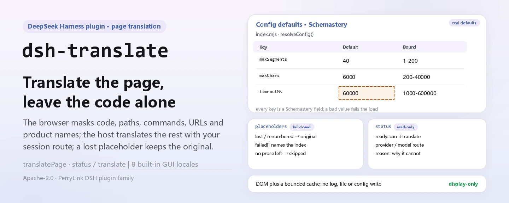
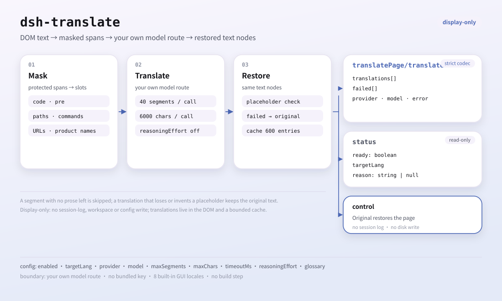
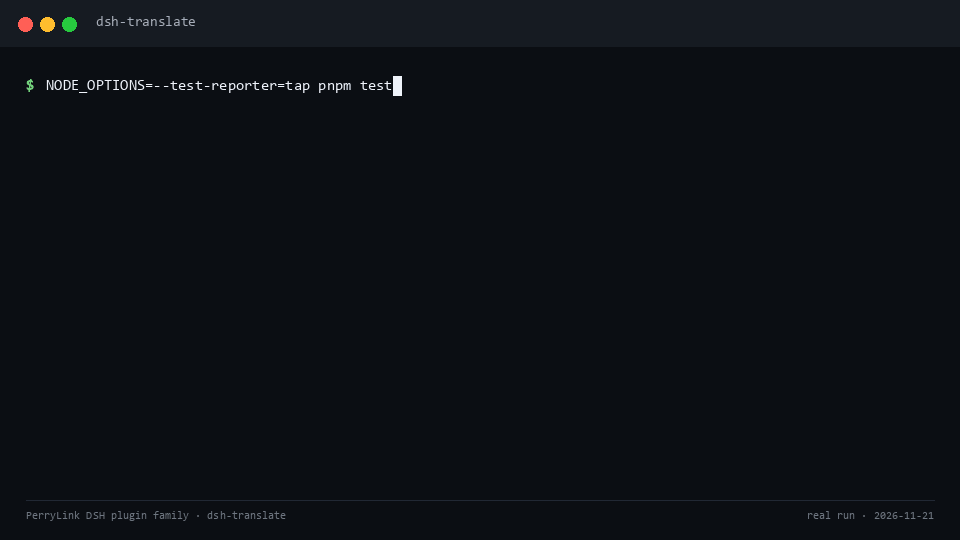

<div align="center">

<picture>
  <source media="(prefers-color-scheme: dark)" srcset="docs/assets/dsh-translate-hero-en-dark.webp">
  
</picture>

</div>

# dsh-translate

Current version `0.3.8`.

**Translate the whole interface into your language — with your own DSH model route, and without touching code, paths, commands or product names.**

An end-to-end translator for DeepSeek Harness. The browser half walks the page's text, masks every span that must stay verbatim (code blocks and inline code, file paths, shell commands, URLs, identifiers, versions, hashes, numbers, product names) into, `⟦n⟧` placeholders, and sends the remaining prose to the host half. The host translates with **the model route your current session already uses**, the browser restores the placeholders and writes the result back into the same text nodes. Originals stay in memory; one click on **Original** restores the page.

Display-only by design: the session log, the workspace and the DSH config are never written. The transcript keeps exactly what the model said.

> **Since 0.3.0, `dsh-translate` is the full-page translator.** The former "vendor parameter
> mapping + deterministic JSON repair" plugin is now
> [`dsh-param-repair`](https://github.com/PerryLink/dsh-param-repair) (1.0.0). If you upgraded from
> 0.2.x and need that behaviour, install `dsh-param-repair` and remove this row; old config keys
> (`repair.*`, `rosettaDataPath`) are ignored by the new plugin and do not fail the profile.

Last verified on DeepSeek Harness `dsh-v0.2.3-alpha.1` (2026-11-22).

[English](README.en.md) · [简体中文](README.md) · [Español](README-es.md) · [Português](README-pt.md) · [हिन्दी](README-hi.md)

## What is translated

| Translated | Kept verbatim |
|---|---|
| Assistant prose, reasoning summaries, tool output prose | Fenced and inline code (`code` / `pre`) |
| Markdown headings, lists, tables, link labels | File paths, globs, commands and flags, URLs, emails |
| Buttons, labels, settings copy | JSON keys, env vars, `dsh-*` / `snake_case` / `camelCase` identifiers |
| Copy from other plugins (hidden popovers included) | Versions, hashes, plain numbers, and the `⟦n⟧` placeholders |
| — | Product terms: DeepSeek Harness, Cordis, npm, GitHub, Gitee, GitCode, Phocinae, PerryLink, … |

A text node with no prose left (for example a path or a code span) is skipped. If the model loses, renumbers or invents a placeholder, that segment keeps its original text instead of writing a half-masked string into the page.

<picture>
  <source media="(prefers-color-scheme: dark)" srcset="docs/assets/dsh-translate-flow-v5-dark.svg">
  
</picture>

*Structure: mask → translate → restore; `translatePage/translate` returns `translations[]`, `failed[]` and the provider and model actually used, while `status` only reports whether a route is resolvable. The token labels inside the diagram are the real method, field and config names, so the same picture serves all five languages.*

## Install

```sh
dsh plugin --profile <name> add dsh-translate
```

Reload the Web GUI: a **Translate** pill appears at the bottom-right. Click once to translate the page (it becomes **Original**); click again to restore.

## Requirements

Translation uses **your own model**, with no bundled key and no bundled provider:

1. The profile needs an `llm` service and a working provider (a normal chat already proves it);
2. The route defaults to the newest `request/header` recorded by a live session, so send one message first — or pin `provider` / `model` in the config.

Without a route the control shows the reason (for example `no model route: …`) and the page is left untouched.

## Configuration

Every key is a Schemastery field; an invalid value fails the profile load loudly.

| Key | Default | Meaning |
|---|---|---|
| `enabled` | `true` | Master switch; `false` mounts nothing |
| `targetLang` | `''` | Target language; empty follows the Web GUI locale (browser language when the UI is English) |
| `provider` / `model` | `''` | Optional explicit route; **both or neither**; empty inherits the newest session route |
| `maxSegments` | `40` | Segments per model call (1–200) |
| `maxChars` | `6000` | Characters per model call (200–40000) |
| `timeoutMs` | `60000` | Per-call deadline (1000–600000) |
| `reasoningEffort` | `off` | Thinking effort per call: `off`, `low`, `high`, `max`; `off` disables thinking so a translation batch never pays for chain-of-thought |
| `glossary` | `[]` | Extra terms to keep verbatim |

Example: force Japanese and protect internal product names:

```yaml
- id: dsh-translate
  name: dsh-translate
  config:
    enabled: true
    targetLang: ja
    glossary: [Acme Ledger, Internal Ticketing]
```

## Cost and privacy

- **On demand, page text only (hidden popovers are translated before they open)**: nothing runs in the background until the control is clicked; turning it off stops the work.
- **Cache**: the same source segment (same target language) is translated once and cached in browser `localStorage` (600 entries max); clearing site data clears it.
- **What leaves the machine**: only prose with protected spans masked, sent to the provider you configured; paths, code, commands and key-shaped identifiers are not sent as translatable text.
- **No persistence**: translations live in the DOM and the browser cache; the session log, workspace and DSH config are untouched.
- **No credentials**: the plugin never reads or stores an API key; authentication stays with the host provider configuration.

## Known limitations

- Translation happens at the render layer. When React re-renders a node it writes the original back; the MutationObserver re-applies the cached translation without another model call. A brief flicker is possible.
- Streaming text keeps changing, so the plugin translates after a 350 ms quiet period; long streaming replies get their translation a little later.
- No OCR for images, Canvas or PDF previews.
- Hidden elements (`display:none` popovers) are walked too, so a popover opens already translated without another model call.
- The GUI itself already ships eight locales (en / zh / ja / es / fr / de / ru / pt); this plugin translates **content** and English copy from third-party plugins, and does not replace the built-in locale system.

## Development

```sh
pnpm install
pnpm test        # 21 cases: masking/restore, placeholder checks, batching, route resolution, jsdom DOM behaviour, descriptor parity
pnpm run lint
```

Layout:

- `index.mjs` — host entry (Config + service mount)
- `lib/service.mjs` — the `translatePage` Typert service (status / translate)
- `lib/engine.mjs` — prompt, batching, parsing, placeholder verification (no cordis, no DOM; unit-tested)
- `lib/wire.mjs` — the invocation descriptors shared by both faces
- `typert.host.mjs` — host Typert manifest
- `client/index.js` — hand-written client bundle: DOM walk, masking, cache, floating control



*Animated: the real `pnpm test` run in this checkout on 2026-11-21, replayed through Node's TAP reporter — 32 tests, 0 failures, 4.6 s, no network. The count in the Development snippet above is the suite as it stood when that line was written; this replay is the current output.*

## License

Apache-2.0. A community plugin; not affiliated with DeepSeek.
