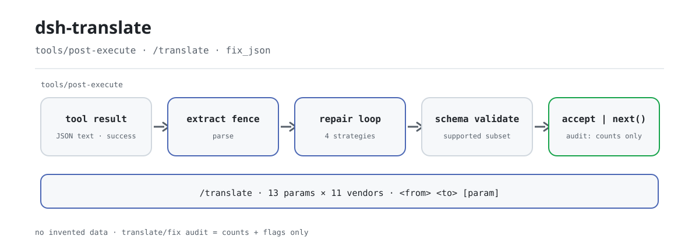

<div align="center">

<picture>
  <source media="(prefers-color-scheme: dark)" srcset="docs/assets/dsh-translate-flow-dark.svg">
  
</picture>

# dsh-translate

**Make the same request work on every vendor — broken JSON fixed on the spot, never with invented data.**

A pure host-side plugin for DeepSeek Harness: `/translate` maps 13 canonical parameters across 11 vendors, and the `tools/post-execute` repair layer plus the `fix_json` tool deterministically repair broken JSON in successful tool results until it passes schema validation.

[Install](#three-step-setup) · [Configuration](#configuration) · [FAQ](#faq) · [简体中文](README.md) · [English](README.en.md) · [Español](README.es.md) · [Português](README.pt.md) · [हिन्दी](README.hi.md)

[](LICENSE)
[](#compatibility)
[](https://www.npmjs.com/package/dsh-translate)
[](https://github.com/PerryLink/dsh-translate/actions/workflows/ci.yml)
[](#compatibility)

[](https://github.com/PerryLink/dsh-translate/stargazers)
[](https://www.npmjs.com/package/dsh-translate)
[](https://dshfind.com/plugins/PerryLink/dsh-translate?ref=badge)
[](https://securityscorecards.dev/viewer/?uri=github.com/PerryLink/dsh-translate)
[](https://dsh.market/)
[](https://gitee.com/perrylink/dsh-translate)

```sh
dsh plugin --profile <name> add dsh-translate
```

</div>

<sub>Community plugin, not affiliated with DeepSeek. Canonical repository: <https://github.com/PerryLink/dsh-translate> (Gitee is a mirror).</sub>

## What it is

`dsh-translate` does two independent things. The first is **vendor parameter translation**: canonical parameters such as `temperature`, `top_p`, `max_tokens`, `stop`, and `system` are mapped onto the real field names of 11 vendors (OpenAI, ERNIE, Qwen, Anthropic, Google, DeepSeek, Mistral, Cohere, xAI, Groq, Azure) — look up one mapping with `/translate openai ernie max_tokens`, or convert a whole standard request through `transformRequest` in `lib/rosetta.mjs`. The second is **deterministic JSON repair**: when a successful tool result carries broken JSON as a string, the `tools/post-execute` listener extracts the fence, parses, and runs four text strategies until the payload passes schema validation — if it cannot be repaired, the original value passes through untouched and no value is ever invented.

The "translate" in the name is a vendor parameter mapping table, not machine translation. Pure host, pure ESM, no build step: `index.mjs` and `lib/` are the shipped artifacts.

## Three-step setup

1. **Install** (pick one):

   ```sh
   # git channel (latest main; equivalent to git+https://github.com/PerryLink/dsh-translate.git)
   dsh plugin --profile web add github:PerryLink/dsh-translate
   # npm channel (published releases)
   dsh plugin --profile web add dsh-translate
   # tarball channel: after pnpm pack in this repo
   dsh plugin --profile web add ./dsh-translate-<version>.tgz
   ```

   No build step — `index.mjs` and `lib/` are the shipped artifacts.

2. **Minimal config** (the defaults already work; touch keys only when needed):

   ```yaml
   - insert:
       - id: dsh-translate
         name: dsh-translate
         config:
           enabled: true
           repair:
             enabled: true
           registerCommand: true
           registerTool: true
   ```

3. **Verify it took effect**:

   ```sh
   dsh --profile web --dump-config | grep -A2 'id: dsh-translate'
   ```

   ```
   > /translate openai ernie max_tokens
   openai (OpenAI) → ernie (Baidu ERNIE (Wenxin)):
     max_tokens: max_tokens → max_output_tokens
   ```

**Uninstall**: `dsh plugin --profile web remove dsh-translate` (or remove the row from the profile patch).

<details>
<summary>Install from the DSH Desktop market</summary>

Every PerryLink plugin is browsable in the DSH Desktop built-in market: **Market → Sources → Add source → paste** `https://perrylink-dsh-catalog.perrylink.workers.dev/catalog-source.json` **→ select**. Installation still goes through the market's npm identity check and your confirmation.

</details>

## Core capabilities

Two independent surfaces in one bundle: the parameter translation table, and the post-hoc repair layer.

- **`/translate` parameter map** — 13 canonical parameters (`temperature`, `top_p`, `max_tokens`, `stop`, `system`, and 8 more) mapped onto the real field names of **11 vendors**; query any pairwise single-parameter mapping, list vendors/params, or convert a whole request through `transformRequest`.
- **Repair layer** — a `tools/post-execute` listener plus the `fix_json` tool: when a successful tool result carries broken JSON as a string (string-rooted or `json`-rooted output schema, or opted in by `repair.toolNames`), it repairs through fence extraction, escape repair, trailing-comma removal, truncation closure, and required-field `null` completion until the payload validates.
- **No invented data** — `null` is a placeholder only and lands only when the schema accepts `null`; a result that cannot be repaired passes through untouched; failed tool results are never flipped into successes.
- **Counts-only audit** — the `translate/fix` session event records tool name, call id, strategy names, edit counts, and truncation flags, never payloads; the write is additionally gated by the host's event vocabulary.
- **Hostile input bounded** — only the keyword subset the harness tool registry supports is accepted; other keywords are rejected as unsupported rather than silently ignored; circular schemas and exponential `oneOf` shapes hit depth and branch budgets.

```text
tool result (success, JSON text) ──▶ extract fence ──▶ parse
    │ ok? ──▶ schema-validate ──▶ accept { kind: 'accept', value }  (registry re-validates + re-renders)
    │ broken ──▶ escape / trailing-comma / close / fill-null ──▶ validate
    │ unrepairable ──▶ next()  (original value preserved) + translate/fix audit (counts only)
```

### Command and tool surface

| Surface | Kind | Notes |
|---|---|---|
| `/translate` | command | `vendors`, `params`, or `<from> <to> [param]` pairwise mapping |
| `fix_json` | tool | `{ text, schema?, strategies? }` → `{ ok, repaired?, diff?, strategies, truncated, validated, error? }`; diff fragments are bounded and sanitized |
| post-execute repair | listener | Automatic for successful string results from string-rooted / `json`-rooted schemas (plus `repair.toolNames`); always calls `next()` unless it claims the call |

### Examples

These are the plugin's real entry points; install once, then call one.

**Detailed example** — command `/translate openai ernie max_tokens`:

```text
openai (OpenAI) → ernie (Baidu ERNIE (Wenxin)):
  max_tokens: max_tokens → max_output_tokens
```

*Observed from `README.md:107-110; index.mjs:372-385; test/index.test.mjs:100-105`*

**Failure branch** — input `{"text":"{}","schema":{"pattern":"x"}}`:

```text
fix_json failed (INVALID_SCHEMA): #.pattern is not a supported keyword (subset: type/oneOf/properties/required/additionalProperties/items/enum/const)
```

*Observed from `plugins/dsh-translate/index.mjs:486-488; plugins/dsh-translate/lib/fix.mjs:241; plugins/dsh-translate/test/index.test.mjs:347-352`*

**Brief examples**: `fix_json` · `/translate openai ernie max_tokens`

## Configuration

All tunables are Schemastery `Config` fields (changeable from cordis.yml). An id-targeted override replaces the whole row — restate every key you need. `cordis.patch.yml` documents each key inline.

Most-used keys:

| Key | Default | Meaning |
|---|---|---|
| `enabled` | `true` | Master switch; `false` registers nothing |
| `repair.enabled` | `true` | Post-execute repair layer switch |
| `repair.toolNames` | `[]` | Extra tool names whose JSON-text results may be repaired (on top of string-rooted / `json`-rooted schemas) |
| `repair.maxSteps` | `8` | Strategy application budget (repair-loop passes, 1..64) |
| `diffMaxChars` | `200` | Cap on one logged diff fragment, in characters |
| `registerCommand` | `true` | Register the `/translate` command |
| `registerTool` | `true` | Register the `fix_json` tool |

<details>
<summary>Full configuration table (13 keys)</summary>

| Key | Default | Meaning |
|---|---|---|
| `enabled` | `true` | Master switch; `false` registers nothing |
| `repair.enabled` | `true` | Post-execute repair layer switch |
| `repair.toolNames` | `[]` | Extra tool names whose JSON-text results may be repaired (on top of string-rooted / `json`-rooted schemas) |
| `repair.strategies.escapeRepair` | `true` | Escape raw control characters inside strings |
| `repair.strategies.trailingComma` | `true` | Remove commas directly before a closing bracket |
| `repair.strategies.truncationClosure` | `true` | Close an unclosed string or container cut off by truncation |
| `repair.strategies.fieldCompletion` | `true` | Complete missing required fields with explicit `null` placeholders |
| `repair.maxSteps` | `8` | Strategy application budget (repair-loop passes, 1..64) |
| `diffMaxChars` | `200` | Cap on one logged diff fragment, in characters |
| `diffMaxEntries` | `50` | Cap on logged diff entries |
| `registerCommand` | `true` | Register the `/translate` command |
| `registerTool` | `true` | Register the `fix_json` tool |
| `rosettaDataPath` | *(none)* | Optional external rosetta data file (same shape as the bundled `lib/rosetta-data.json`); overrides the built-in table, and an invalid file fails the mount loudly |

</details>

Example override in your profile patch:

```yaml
- insert:
    - id: dsh-translate
      name: dsh-translate
      config:
        enabled: true
        repair:
          enabled: true
          toolNames: ['emit-json']
          strategies:
            escapeRepair: true
            trailingComma: true
            truncationClosure: true
            fieldCompletion: true
          maxSteps: 8
        diffMaxChars: 200
        diffMaxEntries: 50
        registerCommand: true
        registerTool: true
```

## FAQ

<details>
<summary>Are the repaired values invented? Do failed tool results get flipped into successes?</summary>

No. Repair is bounded text surgery: escape repair, trailing-comma removal, truncation closure, and required-field completion with explicit `null` — `null` lands only when the schema accepts `null`, otherwise repair fails closed with `SCHEMA_VIOLATION`. Failed results always arrive as failures; an already-valid result is never rewritten. The upstream LLM-retry arm was deliberately not ported, so there is no model call anywhere on the repair path.

</details>

<details>
<summary>Does the `translate/fix` audit event actually reach the session log?</summary>

It depends on the host's event vocabulary. A host that knows `translate/fix` gets the plain two-argument append; a host with the `ignorable` append envelope gets the marked append; hosts with neither (`0.1.0-rc.6`–`0.1.1-rc.2`, `0.1.2-rc.1`, and `0.1.6+`/`0.2.x`, whose private-type vocabulary does not contain it) get no append at all. The gate only affects observability: the session log is never polluted, and the repair outcome never depends on the audit.

</details>

<details>
<summary>Does it contend with other plugins for `tools/post-execute`?</summary>

No. That is a Cordis broadcast event: every listener runs and none can starve another. This plugin claims a call only when it can hand back a replacement that validated; every other path delegates through `next()`, so the chain is never short-circuited and a failure is never flipped.

</details>

<details>
<summary>Does it call a model, use the network, or read credentials?</summary>

It does neither. The plugin has no network, no subprocess, and no credentials — it only consumes the official `commands` and `tools` services. Parameter translation is a pure data lookup; repair is pure deterministic text processing.

</details>

<details>
<summary>What does it cost at runtime? Can a huge schema stall the process?</summary>

Repair is synchronous in-memory text processing with fixed budgets: the strategy loop runs at most `repair.maxSteps` passes (1..64), `oneOf` validation is capped by depth (`MAX_ONE_OF_DEPTH`) and a branch budget (`MAX_ONE_OF_BUDGET`), and diffs are truncated by `diffMaxChars`/`diffMaxEntries`. Unsupported schema keywords and circular schemas are rejected outright.

</details>

## Security boundaries

- **Deterministic only.** Repair is bounded text surgery; the upstream LLM-retry arm of JSON-Schema-Enforcer-Proxy was deliberately not ported — a post-execute listener never calls a model.
- **Fail closed.** Unrepairable syntax and schema violations leave the original result untouched (or return a structured error from `fix_json`); `null` placeholders only land when the schema accepts `null`.
- **Hostile input bounded.** Unsupported schema keywords and circular schemas are rejected; `oneOf` validation is capped by depth (`MAX_ONE_OF_DEPTH`) and a branch budget (`MAX_ONE_OF_BUDGET`), so an exponential schema cannot exhaust the process.
- **No payload leakage.** Logs and audit events never contain repaired payloads; diffs are truncated and capped before display or storage.

## Permissions & data

- **Permissions**: no network, no subprocess, no credentials — the plugin only consumes the official `commands` and `tools` services and appends to the session log.
- **Data**: repair never fabricates values; the only model-visible additions are the repaired canonical value and the `fix_json` diff. Session audit events (`translate/fix`) carry tool name, call id, strategy names, edit counts, and truncation flags — never payloads. The audit write is gated by the host's session-event vocabulary: a host that knows `translate/fix` gets the plain two-argument append, a host with the `ignorable` append envelope gets the marked append, and envelope-less hosts (`0.1.0-rc.6`–`0.1.1-rc.2`, `0.1.2-rc.1`) plus `0.1.6+`/`0.2.x` (private type absent from the vocabulary) get no append — the tool result remains the model-visible log.
- **0.1.2-rc.1 session envelope** (adapted 2026-09-04): the envelope keeps the ignorable field for reading existing logs only — `Session.append` still cannot stamp it, so the gate behaves exactly as before.

## Known limitations

- The supported JSON Schema subset mirrors the harness tool registry (`type`/`oneOf`/`properties`/`required`/`additionalProperties`/`items`/`enum`/`const`); other keywords are rejected as unsupported, not silently ignored.
- Repair only applies to successful results whose canonical value is a JSON-text string; a value that already failed schema validation arrives as a failed result and is never flipped.
- The translation table covers 11 vendors × 13 canonical parameters; `extended` rows follow public API references (not the upstream trio) and are marked as such in `lib/rosetta.mjs`.
- On hosts that neither know `translate/fix` nor expose the `ignorable` append envelope — the published `0.1.0-rc.6`–`0.1.1-rc.2` line, `0.1.2-rc.1` (fail-closed on unknown event types at read), and `0.1.6+`/`0.2.x`, whose private-type vocabulary does not contain it — the adaptive gate skips the audit append so the session log is never polluted; the tool result remains the durable evidence until the event type is registered.

## Interoperability with other DSH plugins

Verified against **DSH `0.2.0-rc.2`** (the runtime this README ships for) and the high-star plugin set surveyed on 2026-10-05.

This plugin **does not interfere** with other plugins, including the widely installed high-star ones:

- **No tool-name collision.** Every tool is namespaced; no bare name owned by a shipped tool or another plugin is registered.
- **No service-key collision.** It provides no service key at all, so it cannot collide on one.
- **No slot collision.** It registers no client slot key, so it cannot contend for a `shadows-shipped-ui` seat.
- **No HTTP route collision.** It registers no `webServer` prefix.
- **No patch-layer collision.** The bundle patch only `insert`s its own row; it never overrides a built-in row's `config`.
- **No global mutation.** It does not patch prototypes, rewrite `process.env`, or replace the global fetch dispatcher.

**Shared event listeners are non-interfering by construction.** It observes the ordering-sensitive event `tools/post-execute` with `ctx.on()` — Cordis's broadcast registration, where every listener runs and none can starve another. **Every listener here delegates through `next()`**, so the chain is never short-circuited, and a mutation is applied to the value `next()` produced rather than returned in its place:

- `tools/post-execute` — also used by `cc-safety-net` (1576★).

Static evidence: `dsh-plugin-doctor` K10–K13 report `pass` for every check on this repository.

## Compatibility

| Surface | Status |
|---|---|
| Harness | Main version **`dsh-v0.2.1-alpha.1`** (verified 2026-09-24: dual typecheck rulers + `node --test` 80/80 + self-contained/artifacts gates). `engines.dsh` = `>=0.2.1-0 <0.3.0 \|\| >=0.2.2-0 <0.3.0`; npm dev/test pins `0.2.2-rc.1`. |
| Node | `^22.19.0 \|\| >=24.9.0` |
| Form | Pure-host JS plugin (no browser half, no build step) |
| Model | Any model — repair is fully deterministic and adds no model calls |

## Ecosystem & quality

- [Gitee mirror](https://gitee.com/perrylink/dsh-translate) (synced mirror; GitHub stays canonical)
- [dshfind plugin page](https://dshfind.com/plugins/PerryLink/dsh-translate) (install counts and ranking)
- [OpenSSF Scorecard report](https://securityscorecards.dev/viewer/?uri=github.com/PerryLink/dsh-translate) (driven by [.github/workflows/scorecard.yml](.github/workflows/scorecard.yml))
- [dsh-plugin-doctor verification report](https://github.com/PerryLink/dsh-plugin-doctor#verified-徽章) (K10–K13 all `pass`)
- [DSH Market](https://dsh.market/) (listed)
- **1024 store channel**: run `npm i -g dsh1024` once, then `dsh1024 plugin --profile web add dsh-translate` (counts toward the [deepseek1024.com](https://deepseek1024.com) install ranking)
- [Ecosystem knowledge base](https://perrylink.github.io/dsh-plugin-guide/): plugin development guide · measured selection data · maintenance trade-offs

## Development

```sh
pnpm install                    # node ^22.19 || >=24.9
pnpm test                       # node --test: 79 tests (pure lib suites + real-service assembly suite)
pnpm run check                  # tsc checkJs against types.d.ts
pnpm run verify:self-contained  # dependency specs resolve from the registry
pnpm run verify:artifacts       # ESM face imports under plain Node + lib exports present
node scripts/check-readme-sync.mjs  # five-language README sync gate (also in CI)
pnpm pack                       # the published tarball
```

No build step: pure ESM, `index.mjs` and `lib/` are the shipped artifacts. The hero diagrams are generated programmatically by [`scripts/gen-readme-assets.py`](scripts/gen-readme-assets.py) (Python + Pillow) and can be re-run: `python scripts/gen-readme-assets.py` writes the light/dark pair `docs/assets/dsh-translate-flow-{light,dark}.svg`.

Topics: `dsh`, `dsh-plugin`, `deepseek-harness`, `deepseek`, `cordis`, `json-repair`, `schema-validation`, `parameter-mapping`, `llm-api`, `tooling`

## Family & thanks

This project is part of the DeepSeek Harness plugin family maintained by [PerryLink](https://github.com/PerryLink) (all Apache-2.0). If this plugin helps you, **give it a star** — it gates nothing, but it helps the next person find it.

- [@PerryLink](https://github.com/PerryLink) — creator and maintainer: translation table and repair pipeline ports, plugin surfaces, tests, and the five-language docs.

<details>
<summary>Expand all plugins</summary>

| Plugin | Status |
|---|---|
| **[dsh-aqua-input-check](https://github.com/PerryLink/dsh-aqua-input-check)** |  |
| **[dsh-archive-check](https://github.com/PerryLink/dsh-archive-check)** |  |
| **[dsh-auto-review](https://github.com/PerryLink/dsh-auto-review)** |  |
| **[dsh-autotier](https://github.com/PerryLink/dsh-autotier)** | 🧊 FROZEN — see the repo README |
| **[dsh-bid-ca-precheck](https://github.com/PerryLink/dsh-bid-ca-precheck)** |  |
| **[dsh-bid-qual-check](https://github.com/PerryLink/dsh-bid-qual-check)** |  |
| **[dsh-cert-mcp](https://github.com/PerryLink/dsh-cert-mcp)** | 🧊 FROZEN — see the repo README |
| **[dsh-checkpoint-rewind](https://github.com/PerryLink/dsh-checkpoint-rewind)** |  |
| **[dsh-click](https://github.com/PerryLink/dsh-click)** |  |
| **[dsh-composer-history](https://github.com/PerryLink/dsh-composer-history)** |  |
| **[dsh-contract-stance](https://github.com/PerryLink/dsh-contract-stance)** |  |
| **[dsh-customs-doc-check](https://github.com/PerryLink/dsh-customs-doc-check)** |  |
| **[dsh-data-quality](https://github.com/PerryLink/dsh-data-quality)** | 🧊 FROZEN — see the repo README |
| **[dsh-demurrage-ledger](https://github.com/PerryLink/dsh-demurrage-ledger)** |  |
| **[dsh-doublecheck](https://github.com/PerryLink/dsh-doublecheck)** |  |
| **[dsh-drill-script-check](https://github.com/PerryLink/dsh-drill-script-check)** |  |
| **[dsh-eia-guide-check](https://github.com/PerryLink/dsh-eia-guide-check)** |  |
| **[dsh-emergency-plan](https://github.com/PerryLink/dsh-emergency-plan)** |  |
| **[dsh-essay-rubric-check](https://github.com/PerryLink/dsh-essay-rubric-check)** |  |
| **[dsh-evidence-check](https://github.com/PerryLink/dsh-evidence-check)** |  |
| **[dsh-export-ctl-check](https://github.com/PerryLink/dsh-export-ctl-check)** |  |
| **[dsh-fast](https://github.com/PerryLink/dsh-fast)** |  |
| **[dsh-fmea-table-check](https://github.com/PerryLink/dsh-fmea-table-check)** |  |
| **[dsh-forecast-penalty](https://github.com/PerryLink/dsh-forecast-penalty)** |  |
| **[dsh-fund-research](https://github.com/PerryLink/dsh-fund-research)** |  |
| **[dsh-github](https://github.com/PerryLink/dsh-github)** |  |
| **[dsh-gongwen-flow-check](https://github.com/PerryLink/dsh-gongwen-flow-check)** |  |
| **[dsh-gongwen-word-check](https://github.com/PerryLink/dsh-gongwen-word-check)** |  |
| **[dsh-guard-plan-qc](https://github.com/PerryLink/dsh-guard-plan-qc)** |  |
| **[dsh-hazchem-check](https://github.com/PerryLink/dsh-hazchem-check)** |  |
| **[dsh-hazplan-check](https://github.com/PerryLink/dsh-hazplan-check)** |  |
| **[dsh-hidden-risk-map](https://github.com/PerryLink/dsh-hidden-risk-map)** |  |
| **[dsh-hs-classify](https://github.com/PerryLink/dsh-hs-classify)** |  |
| **[dsh-icd-rule-check](https://github.com/PerryLink/dsh-icd-rule-check)** |  |
| **[dsh-industry-research](https://github.com/PerryLink/dsh-industry-research)** |  |
| **[dsh-lawcite-adapter](https://github.com/PerryLink/dsh-lawcite-adapter)** |  |
| **[dsh-laya](https://github.com/PerryLink/dsh-laya)** |  |
| **[dsh-lc-doc-check](https://github.com/PerryLink/dsh-lc-doc-check)** |  |
| **[dsh-learning-gap-check](https://github.com/PerryLink/dsh-learning-gap-check)** |  |
| **[dsh-library](https://github.com/PerryLink/dsh-library)** |  |
| **[dsh-local-ai](https://github.com/PerryLink/dsh-local-ai)** |  |
| **[dsh-lsp-actions](https://github.com/PerryLink/dsh-lsp-actions)** |  |
| **[dsh-mask](https://github.com/PerryLink/dsh-mask)** |  |
| **[dsh-mcp-panel](https://github.com/PerryLink/dsh-mcp-panel)** |  |
| **[dsh-medrec-qc](https://github.com/PerryLink/dsh-medrec-qc)** |  |
| **[dsh-memento](https://github.com/PerryLink/dsh-memento)** | 🧊 FROZEN — see the repo README |
| **[dsh-nsfc-form-check](https://github.com/PerryLink/dsh-nsfc-form-check)** |  |
| **[dsh-nurse-record-check](https://github.com/PerryLink/dsh-nurse-record-check)** |  |
| **[dsh-observe](https://github.com/PerryLink/dsh-observe)** |  |
| **[dsh-origin-rvc-check](https://github.com/PerryLink/dsh-origin-rvc-check)** |  |
| **[dsh-ota-review-check](https://github.com/PerryLink/dsh-ota-review-check)** |  |
| **[dsh-output-styles](https://github.com/PerryLink/dsh-output-styles)** |  |
| **[dsh-paper-doc-adapter](https://github.com/PerryLink/dsh-paper-doc-adapter)** |  |
| **[dsh-permission-rules](https://github.com/PerryLink/dsh-permission-rules)** |  |
| **[dsh-permit-report-check](https://github.com/PerryLink/dsh-permit-report-check)** |  |
| **[dsh-pipeline-check](https://github.com/PerryLink/dsh-pipeline-check)** |  |
| **[dsh-pleading-draft](https://github.com/PerryLink/dsh-pleading-draft)** |  |
| **[dsh-plugin-doctor](https://github.com/PerryLink/dsh-plugin-doctor)** | 🚫 RETIRED (repo archived) |
| **[dsh-plugin-guide](https://github.com/PerryLink/dsh-plugin-guide)** |  |
| **[dsh-plugin-kit](https://github.com/PerryLink/dsh-plugin-kit)** | 🚫 RETIRED (repo archived) |
| **[dsh-plugin-upgrade](https://github.com/PerryLink/dsh-plugin-upgrade)** | 🚫 RETIRED (repo archived) |
| **[dsh-policy-brief-draft](https://github.com/PerryLink/dsh-policy-brief-draft)** |  |
| **[dsh-power-loss-split](https://github.com/PerryLink/dsh-power-loss-split)** |  |
| **[dsh-power-ticket-check](https://github.com/PerryLink/dsh-power-ticket-check)** |  |
| **[dsh-ppap-check](https://github.com/PerryLink/dsh-ppap-check)** |  |
| **[dsh-protest-deadline](https://github.com/PerryLink/dsh-protest-deadline)** |  |
| **[dsh-railway-window](https://github.com/PerryLink/dsh-railway-window)** |  |
| **[dsh-repair-order-qc](https://github.com/PerryLink/dsh-repair-order-qc)** |  |
| **[dsh-research-report](https://github.com/PerryLink/dsh-research-report)** |  |
| **[dsh-review-reply-check](https://github.com/PerryLink/dsh-review-reply-check)** |  |
| **[dsh-rulefile-check](https://github.com/PerryLink/dsh-rulefile-check)** |  |
| **[dsh-safety-brief-check](https://github.com/PerryLink/dsh-safety-brief-check)** |  |
| **[dsh-score](https://github.com/PerryLink/dsh-score)** | 🧊 FROZEN — see the repo README |
| **[dsh-session-sync](https://github.com/PerryLink/dsh-session-sync)** |  |
| **[dsh-site-log-check](https://github.com/PerryLink/dsh-site-log-check)** |  |
| **[dsh-skill-pack-security](https://github.com/PerryLink/dsh-skill-pack-security)** |  |
| **[dsh-soe-decision-check](https://github.com/PerryLink/dsh-soe-decision-check)** |  |
| **[dsh-soilwater-check](https://github.com/PerryLink/dsh-soilwater-check)** |  |
| **[dsh-sop-sync-check](https://github.com/PerryLink/dsh-sop-sync-check)** |  |
| **[dsh-spc-gbt-adapter](https://github.com/PerryLink/dsh-spc-gbt-adapter)** |  |
| **[dsh-talk](https://github.com/PerryLink/dsh-talk)** |  |
| **[dsh-tender-extract](https://github.com/PerryLink/dsh-tender-extract)** |  |
| **[dsh-tender-matrix](https://github.com/PerryLink/dsh-tender-matrix)** |  |
| **[dsh-test-drive](https://github.com/PerryLink/dsh-test-drive)** |  |
| **[dsh-ticktick](https://github.com/PerryLink/dsh-ticktick)** | 🚫 RETIRED (repo archived) |
| **[dsh-translate](https://github.com/PerryLink/dsh-translate)** |  |
| **[dsh-warranty-calc](https://github.com/PerryLink/dsh-warranty-calc)** |  |
| **[dsh-budget](https://github.com/PerryLink/dsh-budget)** |  |
| **[dsh-claude-move](https://github.com/PerryLink/dsh-claude-move)** |  |
| **[dsh-defend](https://github.com/PerryLink/dsh-defend)** |  |
| **[dsh-draw](https://github.com/PerryLink/dsh-draw)** | 🧊 FROZEN — see the repo README |
| **[dsh-reach](https://github.com/PerryLink/dsh-reach)** |  |
| **[dsh-background-agents](https://github.com/PerryLink/dsh-background-agents)** | 🚫 RETIRED (repo archived) |
| **[dsh-session-pin](https://github.com/PerryLink/dsh-session-pin)** | 🚫 RETIRED (repo archived) |
| **[dsh-team-rooms](https://github.com/PerryLink/dsh-team-rooms)** | 🚫 RETIRED (repo archived) |

</details>

## License

[LICENSE](LICENSE) (Apache License 2.0) © 2026 dsh-translate contributors

<p align="center"><sub>Apache-2.0 · Community plugin, not affiliated with DeepSeek.</sub></p>
