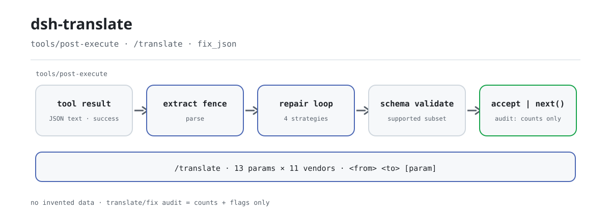

<div align="center">

<picture>
  <source media="(prefers-color-scheme: dark)" srcset="docs/assets/dsh-translate-flow-dark.svg">
  
</picture>

# dsh-translate

**Haz que la misma petición funcione en todos los proveedores: el JSON roto se repara al instante, nunca inventando datos.**

Un plugin puramente host-side para DeepSeek Harness: `/translate` asigna 13 parámetros canónicos a 11 proveedores, y la capa de reparación de `tools/post-execute` junto con la herramienta `fix_json` reparan de forma determinista el JSON roto de los resultados correctos hasta que pasa la validación del esquema.

[Instalar](#instalación-en-tres-pasos) · [Configuración](#configuración) · [FAQ](#faq) · [简体中文](README.md) · [English](README.en.md) · [Español](README.es.md) · [Português](README.pt.md) · [हिन्दी](README.hi.md)

[](LICENSE)
[](#compatibilidad)
[](https://www.npmjs.com/package/dsh-translate)
[](https://github.com/PerryLink/dsh-translate/actions/workflows/ci.yml)
[](#compatibilidad)

[](https://github.com/PerryLink/dsh-translate/stargazers)
[](https://www.npmjs.com/package/dsh-translate)
[](https://dshfind.com/plugins/PerryLink/dsh-translate?ref=badge)
[](https://securityscorecards.dev/viewer/?uri=github.com/PerryLink/dsh-translate)
[](https://dsh.market/)
[](https://gitee.com/perrylink/dsh-translate)

```sh
dsh plugin --profile <name> add dsh-translate
```

</div>

<sub>Plugin de la comunidad, no afiliado a DeepSeek. Repositorio canónico: <https://github.com/PerryLink/dsh-translate> (Gitee es un espejo).</sub>

## Qué es

`dsh-translate` hace dos cosas independientes. La primera es la **traducción de parámetros entre proveedores**: parámetros canónicos como `temperature`, `top_p`, `max_tokens`, `stop` y `system` se asignan a los nombres de campo reales de 11 proveedores (OpenAI, ERNIE, Qwen, Anthropic, Google, DeepSeek, Mistral, Cohere, xAI, Groq, Azure); consulta una correspondencia con `/translate openai ernie max_tokens` o convierte una petición estándar completa con `transformRequest` de `lib/rosetta.mjs`. La segunda es la **reparación determinista de JSON**: cuando un resultado de herramienta correcto lleva JSON roto como texto, el listener de `tools/post-execute` extrae el bloque, analiza y aplica cuatro estrategias de texto hasta que la carga pasa la validación del esquema; si no se puede reparar, el valor original sigue su curso y nunca se inventa un dato.

El "translate" del nombre es una tabla de correspondencia de parámetros, no traducción automática. Host puro, ESM puro, sin paso de compilación: `index.mjs` y `lib/` son el artefacto publicado.

## Instalación en tres pasos

1. **Instalar** (elige una vía):

   ```sh
   # canal git (último main; equivale a git+https://github.com/PerryLink/dsh-translate.git)
   dsh plugin --profile web add github:PerryLink/dsh-translate
   # canal npm (versiones publicadas)
   dsh plugin --profile web add dsh-translate
   # canal tarball: tras pnpm pack en este repositorio
   dsh plugin --profile web add ./dsh-translate-<version>.tgz
   ```

   Sin paso de compilación: `index.mjs` y `lib/` son el artefacto publicado.

2. **Configuración mínima** (los valores por defecto ya funcionan; toca claves solo si hace falta):

   ```yaml
   - insert:
       - id: dsh-translate
         name: dsh-translate
         config:
           enabled: true
           repair:
             enabled: true
           registerCommand: true
           registerTool: true
   ```

3. **Comprobar que está activo**:

   ```sh
   dsh --profile web --dump-config | grep -A2 'id: dsh-translate'
   ```

   ```
   > /translate openai ernie max_tokens
   openai (OpenAI) → ernie (Baidu ERNIE (Wenxin)):
     max_tokens: max_tokens → max_output_tokens
   ```

**Desinstalar**: `dsh plugin --profile web remove dsh-translate` (o elimina la fila del patch del perfil).

<details>
<summary>Instalar desde el mercado de DSH Desktop</summary>

Todos los plugins de PerryLink se pueden explorar en el mercado integrado de DSH Desktop: **Mercado → Fuentes → Añadir fuente → pegar** `https://perrylink-dsh-catalog.perrylink.workers.dev/catalog-source.json` **→ seleccionar**. La instalación sigue pasando por la verificación de identidad npm del mercado y tu confirmación.

</details>

## Capacidades clave

Dos superficies independientes en un solo bundle: la tabla de traducción de parámetros y la capa de reparación posterior.

- **Mapa de parámetros `/translate`** — 13 parámetros canónicos (`temperature`, `top_p`, `max_tokens`, `stop`, `system` y 8 más) asignados a los nombres de campo reales de **11 proveedores**; consulta cualquier correspondencia de un parámetro entre dos proveedores, lista proveedores/parámetros o convierte una petición completa con `transformRequest`.
- **Capa de reparación** — un listener de `tools/post-execute` más la herramienta `fix_json`: cuando un resultado correcto lleva JSON roto como texto (esquema de salida con raíz string o `json`, o activado por `repair.toolNames`), repara mediante extracción del bloque, reparación de escapes, eliminación de comas finales, cierre por truncamiento y relleno de campos obligatorios con `null` hasta que la carga valida.
- **Nunca inventa datos** — `null` es solo un marcador y solo se aplica cuando el esquema acepta `null`; un resultado que no se puede reparar pasa intacto; un resultado fallido nunca se convierte en correcto.
- **Auditoría solo con recuentos** — el evento de sesión `translate/fix` registra nombre de herramienta, call id, nombres de estrategia, número de ediciones y marcas de truncamiento, nunca cargas; además, la escritura está condicionada por el vocabulario de eventos del host.
- **Entrada hostil acotada** — solo se acepta el subconjunto de palabras clave que soporta el registro de herramientas del harness; las demás se rechazan como no soportadas en vez de ignorarse en silencio; los esquemas circulares y los `oneOf` exponenciales chocan con los límites de profundidad y de ramas.

```text
resultado de herramienta (correcto, texto JSON) ──▶ extraer bloque ──▶ analizar
    │ ¿válido? ──▶ validar esquema ──▶ accept { kind: 'accept', value }  (el registro revalida y vuelve a renderizar)
    │ roto ──▶ escape / coma final / cierre / relleno null ──▶ validar
    │ irreparable ──▶ next()  (valor original intacto) + auditoría translate/fix (solo recuentos)
```

### Superficie de comandos y herramientas

| Superficie | Tipo | Notas |
|---|---|---|
| `/translate` | comando | `vendors`, `params`, o correspondencia por pares `<from> <to> [param]` |
| `fix_json` | herramienta | `{ text, schema?, strategies? }` → `{ ok, repaired?, diff?, strategies, truncated, validated, error? }`; los fragmentos de diff son acotados y saneados |
| reparación post-execute | listener | Automática para resultados string correctos de esquemas con raíz string / `json` (más `repair.toolNames`); siempre llama a `next()` salvo que reclame la llamada |

### Ejemplos

Estos son los puntos de entrada reales del plugin; instala una vez y llama a uno.

**Ejemplo detallado** — comando `/translate openai ernie max_tokens`:

```text
openai (OpenAI) → ernie (Baidu ERNIE (Wenxin)):
  max_tokens: max_tokens → max_output_tokens
```

*Observed from `README.md:107-110; index.mjs:372-385; test/index.test.mjs:100-105`*

**Rama de fallo** — entrada `{"text":"{}","schema":{"pattern":"x"}}`:

```text
fix_json failed (INVALID_SCHEMA): #.pattern is not a supported keyword (subset: type/oneOf/properties/required/additionalProperties/items/enum/const)
```

*Observed from `plugins/dsh-translate/index.mjs:486-488; plugins/dsh-translate/lib/fix.mjs:241; plugins/dsh-translate/test/index.test.mjs:347-352`*

**Ejemplos breves**: `fix_json` · `/translate openai ernie max_tokens`

## Configuración

Todas las opciones son campos `Config` de Schemastery (modificables desde cordis.yml). Una sobrescritura dirigida por id reemplaza la fila completa: vuelve a declarar todas las claves que necesites. `cordis.patch.yml` documenta cada clave en línea.

Claves más usadas:

| Clave | Valor por defecto | Significado |
|---|---|---|
| `enabled` | `true` | Interruptor general; `false` no registra nada |
| `repair.enabled` | `true` | Interruptor de la capa de reparación post-execute |
| `repair.toolNames` | `[]` | Nombres extra de herramientas cuyos resultados de texto JSON se pueden reparar (además de los esquemas con raíz string / `json`) |
| `repair.maxSteps` | `8` | Presupuesto de aplicación de estrategias (pasadas del bucle de reparación, 1..64) |
| `diffMaxChars` | `200` | Tope de caracteres de un fragmento de diff registrado |
| `registerCommand` | `true` | Registra el comando `/translate` |
| `registerTool` | `true` | Registra la herramienta `fix_json` |

<details>
<summary>Tabla de configuración completa (13 claves)</summary>

| Clave | Valor por defecto | Significado |
|---|---|---|
| `enabled` | `true` | Interruptor general; `false` no registra nada |
| `repair.enabled` | `true` | Interruptor de la capa de reparación post-execute |
| `repair.toolNames` | `[]` | Nombres extra de herramientas cuyos resultados de texto JSON se pueden reparar (además de los esquemas con raíz string / `json`) |
| `repair.strategies.escapeRepair` | `true` | Escapa caracteres de control sin procesar dentro de cadenas |
| `repair.strategies.trailingComma` | `true` | Elimina comas justo antes de un cierre |
| `repair.strategies.truncationClosure` | `true` | Cierra una cadena o contenedor sin cerrar por truncamiento |
| `repair.strategies.fieldCompletion` | `true` | Completa campos obligatorios ausentes con marcadores `null` explícitos |
| `repair.maxSteps` | `8` | Presupuesto de aplicación de estrategias (pasadas del bucle de reparación, 1..64) |
| `diffMaxChars` | `200` | Tope de caracteres de un fragmento de diff registrado |
| `diffMaxEntries` | `50` | Tope de entradas de diff registradas |
| `registerCommand` | `true` | Registra el comando `/translate` |
| `registerTool` | `true` | Registra la herramienta `fix_json` |
| `rosettaDataPath` | *(none)* | Archivo de datos rosetta externo opcional (misma forma que el `lib/rosetta-data.json` incluido); sobrescribe la tabla integrada y un archivo inválido hace fallar el montaje de forma ruidosa |

</details>

Ejemplo de sobrescritura en el patch del perfil:

```yaml
- insert:
    - id: dsh-translate
      name: dsh-translate
      config:
        enabled: true
        repair:
          enabled: true
          toolNames: ['emit-json']
          strategies:
            escapeRepair: true
            trailingComma: true
            truncationClosure: true
            fieldCompletion: true
          maxSteps: 8
        diffMaxChars: 200
        diffMaxEntries: 50
        registerCommand: true
        registerTool: true
```

## FAQ

<details>
<summary>¿Los valores reparados son inventados? ¿Un resultado fallido puede volverse correcto?</summary>

No. La reparación es cirugía de texto acotada: reparación de escapes, eliminación de comas finales, cierre por truncamiento y relleno de campos obligatorios con `null`; `null` solo se aplica cuando el esquema acepta `null`, y si no, la reparación falla cerrada con `SCHEMA_VIOLATION`. Un resultado fallido siempre llega como fallo; un resultado ya válido nunca se reescribe. La rama de reintento con LLM del proyecto original no se portó a propósito, así que no hay ninguna llamada a modelo en la ruta de reparación.

</details>

<details>
<summary>¿El evento de auditoría `translate/fix` llega realmente al registro de sesión?</summary>

Depende del vocabulario de eventos del host. Un host que conoce `translate/fix` recibe el append simple de dos argumentos; un host con el sobre `ignorable` recibe el append marcado; los hosts sin ninguno de los dos (`0.1.0-rc.6`–`0.1.1-rc.2`, `0.1.2-rc.1` y `0.1.6+`/`0.2.x`, cuyo vocabulario de tipos privados no lo contiene) no reciben append. La puerta solo afecta a la observabilidad: el registro de sesión nunca se contamina y el resultado de la reparación nunca depende de la auditoría.

</details>

<details>
<summary>¿Compite con otros plugins por `tools/post-execute`?</summary>

No. Es un evento de difusión de Cordis: todos los listeners se ejecutan y ninguno puede dejar sin turno a otro. Este plugin reclama una llamada solo cuando puede devolver un reemplazo que ya validó; cualquier otra ruta delega en `next()`, así que la cadena nunca se cortocircuita y un fallo nunca se invierte.

</details>

<details>
<summary>¿Llama a un modelo, usa la red o lee credenciales?</summary>

No. El plugin no tiene red, ni subprocesos, ni credenciales: solo consume los servicios oficiales `commands` y `tools`. La traducción de parámetros es una consulta de datos pura; la reparación es procesamiento de texto determinista.

</details>

<details>
<summary>¿Cuánto cuesta en ejecución? ¿Un esquema enorme puede bloquear el proceso?</summary>

La reparación es procesamiento de texto en memoria y síncrono, con presupuestos fijos: el bucle de estrategias hace como máximo `repair.maxSteps` pasadas (1..64), la validación `oneOf` está acotada por profundidad (`MAX_ONE_OF_DEPTH`) y por un presupuesto de ramas (`MAX_ONE_OF_BUDGET`), y los diffs se recortan con `diffMaxChars`/`diffMaxEntries`. Las palabras clave de esquema no soportadas y los esquemas circulares se rechazan de inmediato.

</details>

## Límites de seguridad

- **Solo determinista.** La reparación es cirugía de texto acotada; la rama de reintento con LLM del upstream JSON-Schema-Enforcer-Proxy no se portó a propósito: un listener post-execute nunca llama a un modelo.
- **Fallo cerrado.** Las violaciones de sintaxis y de esquema no reparables dejan el resultado original intacto (o devuelven un error estructurado desde `fix_json`); los marcadores `null` solo se aplican cuando el esquema acepta `null`.
- **Entrada hostil acotada.** Las palabras clave de esquema no soportadas y los esquemas circulares se rechazan; la validación `oneOf` está limitada por profundidad (`MAX_ONE_OF_DEPTH`) y por un presupuesto de ramas (`MAX_ONE_OF_BUDGET`), de modo que un esquema exponencial no puede agotar el proceso.
- **Sin fuga de cargas.** Los registros y eventos de auditoría nunca contienen cargas reparadas; los diffs se recortan y se limitan antes de mostrarse o almacenarse.

## Permisos y datos

- **Permisos**: sin red, sin subprocesos, sin credenciales: el plugin solo consume los servicios oficiales `commands` y `tools` y escribe en el registro de sesión.
- **Datos**: la reparación nunca inventa valores; las únicas adiciones visibles para el modelo son el valor canónico reparado y el diff de `fix_json`. Los eventos de auditoría de sesión (`translate/fix`) llevan nombre de herramienta, call id, nombres de estrategia, número de ediciones y marcas de truncamiento, nunca cargas. La escritura de auditoría está condicionada por el vocabulario de eventos del host: un host que conoce `translate/fix` recibe el append simple de dos argumentos, un host con el sobre `ignorable` recibe el append marcado, y los hosts sin sobre (`0.1.0-rc.6`–`0.1.1-rc.2`, `0.1.2-rc.1`) más `0.1.6+`/`0.2.x` (tipo privado ausente del vocabulario) no reciben append; el resultado de la herramienta sigue siendo el registro visible para el modelo.
- **Sobre de sesión de `0.1.2-rc.1`** (adaptado el 2026-09-04): el sobre conserva el campo ignorable solo para leer registros existentes; `Session.append` sigue sin poder estamparlo, así que la puerta se comporta igual que antes.

## Limitaciones conocidas

- El subconjunto de JSON Schema soportado replica el registro de herramientas del harness (`type`/`oneOf`/`properties`/`required`/`additionalProperties`/`items`/`enum`/`const`); las demás palabras clave se rechazan como no soportadas, no se ignoran en silencio.
- La reparación solo se aplica a resultados correctos cuyo valor canónico es una cadena con texto JSON; un valor que ya falló la validación de esquema llega como resultado fallido y nunca se invierte.
- La tabla de traducción cubre 11 proveedores × 13 parámetros canónicos; las filas `extended` siguen referencias públicas de API (no el trío del upstream) y se marcan como tales en `lib/rosetta.mjs`.
- En hosts que no conocen `translate/fix` ni exponen el sobre de append `ignorable` —la línea publicada `0.1.0-rc.6`–`0.1.1-rc.2`, `0.1.2-rc.1` (fallo cerrado ante tipos de evento desconocidos al leer) y `0.1.6+`/`0.2.x`, cuyo vocabulario de tipos privados no lo contiene— la puerta adaptativa omite el append de auditoría para que el registro de sesión nunca se contamine; el resultado de la herramienta sigue siendo la evidencia duradera hasta que se registre el tipo de evento.

## Interoperabilidad con otros plugins DSH

Verificado contra **DSH `0.2.0-rc.2`** (el runtime al que apunta este README) y el conjunto de plugins con más estrellas medido el 2026-10-05.

Este plugin **no interfiere** con otros plugins, incluidos los de más estrellas y amplia instalación:

- **Sin colisión de nombres de herramienta.** Cada herramienta tiene espacio de nombres; no se registra ningún nombre desnudo propiedad de una herramienta incluida u otro plugin.
- **Sin colisión de claves de servicio.** No ofrece ninguna clave de servicio, así que no puede colisionar en una.
- **Sin colisión de slots.** No registra ninguna clave de slot de cliente, así que no compite por un asiento de `shadows-shipped-ui`.
- **Sin colisión de rutas HTTP.** No registra ningún prefijo de `webServer`.
- **Sin colisión de capas de patch.** El patch del bundle solo `insert`a su propia fila; nunca sobrescribe el `config` de una fila integrada.
- **Sin mutación global.** No parchea prototipos, no reescribe `process.env` ni sustituye el dispatcher fetch global.

**Los listeners de eventos compartidos no interfieren por construcción.** Observa el evento sensible al orden `tools/post-execute` con `ctx.on()` —el registro de difusión de Cordis, donde todos los listeners se ejecutan y ninguno puede dejar sin turno a otro—. **Cada listener de aquí delega en `next()`**, así que la cadena nunca se cortocircuita y una mutación se aplica al valor que produjo `next()` en lugar de sustituirlo:

- `tools/post-execute` — also used by `cc-safety-net` (1576★).

Evidencia estática: `dsh-plugin-doctor` K10–K13 informan `pass` en todas las comprobaciones de este repositorio.

## Compatibilidad

| Superficie | Estado |
|---|---|
| Harness | Versión principal **`dsh-v0.2.1-alpha.1`** (verificado el 2026-09-24: doble regla de typecheck + `node --test` 80/80 + puertas self-contained/artifacts). `engines.dsh` = `>=0.2.1-0 <0.3.0 \|\| >=0.2.2-0 <0.3.0`; pines npm dev/test `0.2.2-rc.1`. |
| Node | `^22.19.0 \|\| >=24.9.0` |
| Forma | Plugin JS puramente host (sin mitad de navegador, sin paso de compilación) |
| Modelo | Cualquier modelo: la reparación es totalmente determinista y no añade llamadas al modelo |

## Ecosistema y calidad

- [Espejo en Gitee](https://gitee.com/perrylink/dsh-translate) (espejo sincronizado; GitHub sigue siendo la referencia)
- [Página de dshfind](https://dshfind.com/plugins/PerryLink/dsh-translate) (instalaciones y ranking)
- [Informe OpenSSF Scorecard](https://securityscorecards.dev/viewer/?uri=github.com/PerryLink/dsh-translate) (generado por [.github/workflows/scorecard.yml](.github/workflows/scorecard.yml))
- [Informe de verificación de dsh-plugin-doctor](https://github.com/PerryLink/dsh-plugin-doctor#verified-徽章) (K10–K13 todos `pass`)
- [DSH Market](https://dsh.market/) (listado)
- **Canal de la tienda 1024**: ejecuta `npm i -g dsh1024` una vez y luego `dsh1024 plugin --profile web add dsh-translate` (cuenta para el ranking de instalaciones de [deepseek1024.com](https://deepseek1024.com))
- [Base de conocimiento del ecosistema](https://perrylink.github.io/dsh-plugin-guide/): guía de desarrollo de plugins · datos medidos de selección · criterios de mantenimiento

## Desarrollo

```sh
pnpm install                    # node ^22.19 || >=24.9
pnpm test                       # node --test: 79 pruebas (suites puras + suite de ensamblaje con servicios reales)
pnpm run check                  # tsc checkJs contra types.d.ts
pnpm run verify:self-contained  # las dependencias declaradas resuelven desde el registry
pnpm run verify:artifacts       # la cara ESM se importa en Node puro + exportaciones de lib presentes
node scripts/check-readme-sync.mjs  # puerta de sincronización de los cinco READMEs (también en CI)
pnpm pack                       # el tarball publicado
```

Sin paso de compilación: ESM puro, `index.mjs` y `lib/` son el artefacto publicado. Las imágenes hero se generan programáticamente con [`scripts/gen-readme-assets.py`](scripts/gen-readme-assets.py) (Python + Pillow) y se pueden regenerar: `python scripts/gen-readme-assets.py` escribe el par claro/oscuro `docs/assets/dsh-translate-flow-{light,dark}.svg`.

Topics: `dsh`, `dsh-plugin`, `deepseek-harness`, `deepseek`, `cordis`, `json-repair`, `schema-validation`, `parameter-mapping`, `llm-api`, `tooling`

## Familia y agradecimientos

Este proyecto forma parte de la familia de plugins de DeepSeek Harness mantenida por [PerryLink](https://github.com/PerryLink) (todos Apache-2.0). Si este plugin te resulta útil, **dale una estrella**: no desbloquea nada, pero ayuda a que la siguiente persona lo encuentre.

- [@PerryLink](https://github.com/PerryLink) — creador y mantenedor: ports de la tabla de traducción y del pipeline de reparación, superficies del plugin, pruebas y la documentación en cinco idiomas.

<details>
<summary>Desplegar todos los plugins</summary>

| Plugin | Estado |
|---|---|
| **[dsh-aqua-input-check](https://github.com/PerryLink/dsh-aqua-input-check)** |  |
| **[dsh-archive-check](https://github.com/PerryLink/dsh-archive-check)** |  |
| **[dsh-auto-review](https://github.com/PerryLink/dsh-auto-review)** |  |
| **[dsh-autotier](https://github.com/PerryLink/dsh-autotier)** | 🧊 CONGELADO — ver el README del repo |
| **[dsh-bid-ca-precheck](https://github.com/PerryLink/dsh-bid-ca-precheck)** |  |
| **[dsh-bid-qual-check](https://github.com/PerryLink/dsh-bid-qual-check)** |  |
| **[dsh-cert-mcp](https://github.com/PerryLink/dsh-cert-mcp)** | 🧊 CONGELADO — ver el README del repo |
| **[dsh-checkpoint-rewind](https://github.com/PerryLink/dsh-checkpoint-rewind)** |  |
| **[dsh-click](https://github.com/PerryLink/dsh-click)** |  |
| **[dsh-composer-history](https://github.com/PerryLink/dsh-composer-history)** |  |
| **[dsh-contract-stance](https://github.com/PerryLink/dsh-contract-stance)** |  |
| **[dsh-customs-doc-check](https://github.com/PerryLink/dsh-customs-doc-check)** |  |
| **[dsh-data-quality](https://github.com/PerryLink/dsh-data-quality)** | 🧊 CONGELADO — ver el README del repo |
| **[dsh-demurrage-ledger](https://github.com/PerryLink/dsh-demurrage-ledger)** |  |
| **[dsh-doublecheck](https://github.com/PerryLink/dsh-doublecheck)** |  |
| **[dsh-drill-script-check](https://github.com/PerryLink/dsh-drill-script-check)** |  |
| **[dsh-eia-guide-check](https://github.com/PerryLink/dsh-eia-guide-check)** |  |
| **[dsh-emergency-plan](https://github.com/PerryLink/dsh-emergency-plan)** |  |
| **[dsh-essay-rubric-check](https://github.com/PerryLink/dsh-essay-rubric-check)** |  |
| **[dsh-evidence-check](https://github.com/PerryLink/dsh-evidence-check)** |  |
| **[dsh-export-ctl-check](https://github.com/PerryLink/dsh-export-ctl-check)** |  |
| **[dsh-fast](https://github.com/PerryLink/dsh-fast)** |  |
| **[dsh-fmea-table-check](https://github.com/PerryLink/dsh-fmea-table-check)** |  |
| **[dsh-forecast-penalty](https://github.com/PerryLink/dsh-forecast-penalty)** |  |
| **[dsh-fund-research](https://github.com/PerryLink/dsh-fund-research)** |  |
| **[dsh-github](https://github.com/PerryLink/dsh-github)** |  |
| **[dsh-gongwen-flow-check](https://github.com/PerryLink/dsh-gongwen-flow-check)** |  |
| **[dsh-gongwen-word-check](https://github.com/PerryLink/dsh-gongwen-word-check)** |  |
| **[dsh-guard-plan-qc](https://github.com/PerryLink/dsh-guard-plan-qc)** |  |
| **[dsh-hazchem-check](https://github.com/PerryLink/dsh-hazchem-check)** |  |
| **[dsh-hazplan-check](https://github.com/PerryLink/dsh-hazplan-check)** |  |
| **[dsh-hidden-risk-map](https://github.com/PerryLink/dsh-hidden-risk-map)** |  |
| **[dsh-hs-classify](https://github.com/PerryLink/dsh-hs-classify)** |  |
| **[dsh-icd-rule-check](https://github.com/PerryLink/dsh-icd-rule-check)** |  |
| **[dsh-industry-research](https://github.com/PerryLink/dsh-industry-research)** |  |
| **[dsh-lawcite-adapter](https://github.com/PerryLink/dsh-lawcite-adapter)** |  |
| **[dsh-laya](https://github.com/PerryLink/dsh-laya)** |  |
| **[dsh-lc-doc-check](https://github.com/PerryLink/dsh-lc-doc-check)** |  |
| **[dsh-learning-gap-check](https://github.com/PerryLink/dsh-learning-gap-check)** |  |
| **[dsh-library](https://github.com/PerryLink/dsh-library)** |  |
| **[dsh-local-ai](https://github.com/PerryLink/dsh-local-ai)** |  |
| **[dsh-lsp-actions](https://github.com/PerryLink/dsh-lsp-actions)** |  |
| **[dsh-mask](https://github.com/PerryLink/dsh-mask)** |  |
| **[dsh-mcp-panel](https://github.com/PerryLink/dsh-mcp-panel)** |  |
| **[dsh-medrec-qc](https://github.com/PerryLink/dsh-medrec-qc)** |  |
| **[dsh-memento](https://github.com/PerryLink/dsh-memento)** | 🧊 CONGELADO — ver el README del repo |
| **[dsh-nsfc-form-check](https://github.com/PerryLink/dsh-nsfc-form-check)** |  |
| **[dsh-nurse-record-check](https://github.com/PerryLink/dsh-nurse-record-check)** |  |
| **[dsh-observe](https://github.com/PerryLink/dsh-observe)** |  |
| **[dsh-origin-rvc-check](https://github.com/PerryLink/dsh-origin-rvc-check)** |  |
| **[dsh-ota-review-check](https://github.com/PerryLink/dsh-ota-review-check)** |  |
| **[dsh-output-styles](https://github.com/PerryLink/dsh-output-styles)** |  |
| **[dsh-paper-doc-adapter](https://github.com/PerryLink/dsh-paper-doc-adapter)** |  |
| **[dsh-permission-rules](https://github.com/PerryLink/dsh-permission-rules)** |  |
| **[dsh-permit-report-check](https://github.com/PerryLink/dsh-permit-report-check)** |  |
| **[dsh-pipeline-check](https://github.com/PerryLink/dsh-pipeline-check)** |  |
| **[dsh-pleading-draft](https://github.com/PerryLink/dsh-pleading-draft)** |  |
| **[dsh-plugin-doctor](https://github.com/PerryLink/dsh-plugin-doctor)** | 🚫 RETIRADO (repo archivado) |
| **[dsh-plugin-guide](https://github.com/PerryLink/dsh-plugin-guide)** |  |
| **[dsh-plugin-kit](https://github.com/PerryLink/dsh-plugin-kit)** | 🚫 RETIRADO (repo archivado) |
| **[dsh-plugin-upgrade](https://github.com/PerryLink/dsh-plugin-upgrade)** | 🚫 RETIRADO (repo archivado) |
| **[dsh-policy-brief-draft](https://github.com/PerryLink/dsh-policy-brief-draft)** |  |
| **[dsh-power-loss-split](https://github.com/PerryLink/dsh-power-loss-split)** |  |
| **[dsh-power-ticket-check](https://github.com/PerryLink/dsh-power-ticket-check)** |  |
| **[dsh-ppap-check](https://github.com/PerryLink/dsh-ppap-check)** |  |
| **[dsh-protest-deadline](https://github.com/PerryLink/dsh-protest-deadline)** |  |
| **[dsh-railway-window](https://github.com/PerryLink/dsh-railway-window)** |  |
| **[dsh-repair-order-qc](https://github.com/PerryLink/dsh-repair-order-qc)** |  |
| **[dsh-research-report](https://github.com/PerryLink/dsh-research-report)** |  |
| **[dsh-review-reply-check](https://github.com/PerryLink/dsh-review-reply-check)** |  |
| **[dsh-rulefile-check](https://github.com/PerryLink/dsh-rulefile-check)** |  |
| **[dsh-safety-brief-check](https://github.com/PerryLink/dsh-safety-brief-check)** |  |
| **[dsh-score](https://github.com/PerryLink/dsh-score)** | 🧊 CONGELADO — ver el README del repo |
| **[dsh-session-sync](https://github.com/PerryLink/dsh-session-sync)** |  |
| **[dsh-site-log-check](https://github.com/PerryLink/dsh-site-log-check)** |  |
| **[dsh-skill-pack-security](https://github.com/PerryLink/dsh-skill-pack-security)** |  |
| **[dsh-soe-decision-check](https://github.com/PerryLink/dsh-soe-decision-check)** |  |
| **[dsh-soilwater-check](https://github.com/PerryLink/dsh-soilwater-check)** |  |
| **[dsh-sop-sync-check](https://github.com/PerryLink/dsh-sop-sync-check)** |  |
| **[dsh-spc-gbt-adapter](https://github.com/PerryLink/dsh-spc-gbt-adapter)** |  |
| **[dsh-talk](https://github.com/PerryLink/dsh-talk)** |  |
| **[dsh-tender-extract](https://github.com/PerryLink/dsh-tender-extract)** |  |
| **[dsh-tender-matrix](https://github.com/PerryLink/dsh-tender-matrix)** |  |
| **[dsh-test-drive](https://github.com/PerryLink/dsh-test-drive)** |  |
| **[dsh-ticktick](https://github.com/PerryLink/dsh-ticktick)** | 🚫 RETIRADO (repo archivado) |
| **[dsh-translate](https://github.com/PerryLink/dsh-translate)** |  |
| **[dsh-warranty-calc](https://github.com/PerryLink/dsh-warranty-calc)** |  |
| **[dsh-budget](https://github.com/PerryLink/dsh-budget)** |  |
| **[dsh-claude-move](https://github.com/PerryLink/dsh-claude-move)** |  |
| **[dsh-defend](https://github.com/PerryLink/dsh-defend)** |  |
| **[dsh-draw](https://github.com/PerryLink/dsh-draw)** | 🧊 CONGELADO — ver el README del repo |
| **[dsh-reach](https://github.com/PerryLink/dsh-reach)** |  |
| **[dsh-background-agents](https://github.com/PerryLink/dsh-background-agents)** | 🚫 RETIRADO (repo archivado) |
| **[dsh-session-pin](https://github.com/PerryLink/dsh-session-pin)** | 🚫 RETIRADO (repo archivado) |
| **[dsh-team-rooms](https://github.com/PerryLink/dsh-team-rooms)** | 🚫 RETIRADO (repo archivado) |

</details>

## Licencia

[LICENSE](LICENSE) (Apache License 2.0) © 2026 dsh-translate contributors

<p align="center"><sub>Apache-2.0 · Plugin de la comunidad, no afiliado a DeepSeek.</sub></p>
