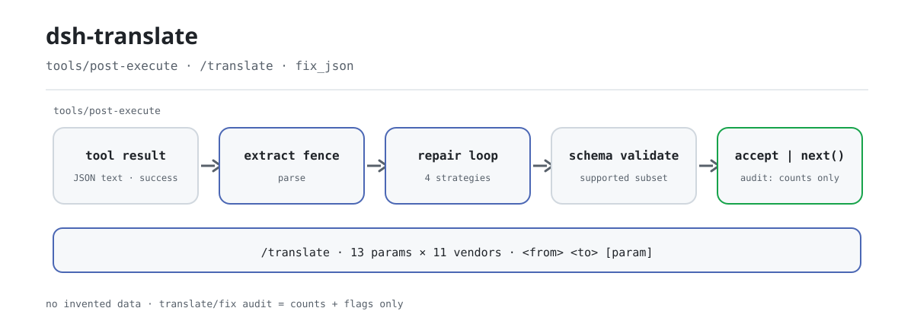

<div align="center">

<picture>
  <source media="(prefers-color-scheme: dark)" srcset="docs/assets/dsh-translate-flow-dark.svg">
  
</picture>

# dsh-translate

**एक ही अनुरोध हर वेंडर पर चलाएँ — टूटा हुआ JSON वहीं ठीक हो जाता है, कभी डेटा गढ़कर नहीं।**

DeepSeek Harness के लिए शुद्ध host-side प्लगइन: `/translate` 13 कैनोनिकल पैरामीटर को 11 वेंडर पर मैप करता है, और `tools/post-execute` रिपेयर परत तथा `fix_json` टूल सफल टूल परिणामों के टूटे JSON को तब तक नियतात्मक रूप से ठीक करते हैं जब तक वह स्कीमा सत्यापन पास न कर ले।

[इंस्टॉल](#तीन-चरणों-में-शुरुआत) · [कॉन्फ़िगरेशन](#कॉन्फ़िगरेशन) · [FAQ](#faq) · [简体中文](README.md) · [English](README.en.md) · [Español](README.es.md) · [Português](README.pt.md) · [हिन्दी](README.hi.md)

[](LICENSE)
[](#संगतता)
[](https://www.npmjs.com/package/dsh-translate)
[](https://github.com/PerryLink/dsh-translate/actions/workflows/ci.yml)
[](#संगतता)

[](https://github.com/PerryLink/dsh-translate/stargazers)
[](https://www.npmjs.com/package/dsh-translate)
[](https://dshfind.com/plugins/PerryLink/dsh-translate?ref=badge)
[](https://securityscorecards.dev/viewer/?uri=github.com/PerryLink/dsh-translate)
[](https://dsh.market/)
[](https://gitee.com/perrylink/dsh-translate)

```sh
dsh plugin --profile <name> add dsh-translate
```

</div>

<sub>समुदाय प्लगइन, DeepSeek से संबद्ध नहीं। एकमात्र रेपो: <https://github.com/PerryLink/dsh-translate> (Gitee प्रतिबिंब है)।</sub>

## यह क्या है

`dsh-translate` दो अलग-अलग काम करता है। पहला है **वेंडर पैरामीटर अनुवाद**: `temperature`, `top_p`, `max_tokens`, `stop`, `system` जैसे कैनोनिकल पैरामीटर 11 वेंडर (OpenAI, ERNIE, Qwen, Anthropic, Google, DeepSeek, Mistral, Cohere, xAI, Groq, Azure) के वास्तविक फ़ील्ड नामों पर मैप होते हैं; `/translate openai ernie max_tokens` से कोई एक मैपिंग देखें, या `lib/rosetta.mjs` के `transformRequest` से पूरा मानक अनुरोध बदलें। दूसरा है **नियतात्मक JSON रिपेयर**: जब कोई सफल टूल परिणाम टूटा हुआ JSON पाठ के रूप में लेकर आता है, तो `tools/post-execute` लिसनर फ़ेंस निकालता है, पार्स करता है और चार पाठ रणनीतियाँ तब तक चलाता है जब तक पेलोड स्कीमा सत्यापन पास न कर ले — ठीक न हो सके तो मूल मान ज्यों का त्यों आगे बढ़ता है और कोई मान कभी गढ़ा नहीं जाता।

नाम का "translate" वेंडर पैरामीटर मैपिंग तालिका है, मशीन अनुवाद नहीं। शुद्ध host, शुद्ध ESM, कोई बिल्ड चरण नहीं: `index.mjs` और `lib/` ही प्रकाशित आर्टिफ़ैक्ट हैं।

## तीन चरणों में शुरुआत

1. **इंस्टॉल करें** (कोई एक मार्ग चुनें):

   ```sh
   # git मार्ग (नवीनतम main; git+https://github.com/PerryLink/dsh-translate.git के बराबर)
   dsh plugin --profile web add github:PerryLink/dsh-translate
   # npm मार्ग (प्रकाशित संस्करण)
   dsh plugin --profile web add dsh-translate
   # tarball मार्ग: इस रेपो में pnpm pack के बाद
   dsh plugin --profile web add ./dsh-translate-<version>.tgz
   ```

   कोई बिल्ड चरण नहीं — `index.mjs` और `lib/` ही प्रकाशित आर्टिफ़ैक्ट हैं।

2. **न्यूनतम कॉन्फ़िग** (डिफ़ॉल्ट पहले से काम करते हैं; ज़रूरत पड़े तभी कुंजियाँ बदलें):

   ```yaml
   - insert:
       - id: dsh-translate
         name: dsh-translate
         config:
           enabled: true
           repair:
             enabled: true
           registerCommand: true
           registerTool: true
   ```

3. **जाँचें कि सक्रिय है**:

   ```sh
   dsh --profile web --dump-config | grep -A2 'id: dsh-translate'
   ```

   ```
   > /translate openai ernie max_tokens
   openai (OpenAI) → ernie (Baidu ERNIE (Wenxin)):
     max_tokens: max_tokens → max_output_tokens
   ```

**अनइंस्टॉल**: `dsh plugin --profile web remove dsh-translate` (या प्रोफ़ाइल पैच से वह पंक्ति हटा दें)।

<details>
<summary>DSH Desktop मार्केट से इंस्टॉल करना</summary>

सभी PerryLink प्लगइन DSH Desktop के अंतर्निहित मार्केट में देखे जा सकते हैं: **मार्केट → स्रोत → स्रोत जोड़ें → चिपकाएँ** `https://perrylink-dsh-catalog.perrylink.workers.dev/catalog-source.json` **→ चुनें**। इंस्टॉल अब भी मार्केट के npm पहचान सत्यापन और आपकी पुष्टि से होता है।

</details>

## मुख्य क्षमताएँ

एक ही बंडल में दो स्वतंत्र सतहें: पैरामीटर अनुवाद तालिका और बाद में चलने वाली रिपेयर परत।

- **`/translate` पैरामीटर मैप** — 13 कैनोनिकल पैरामीटर (`temperature`, `top_p`, `max_tokens`, `stop`, `system` और 8 अन्य) **11 वेंडर** के वास्तविक फ़ील्ड नामों पर मैप; किन्हीं दो वेंडर के बीच एक पैरामीटर की मैपिंग देखें, वेंडर/पैरामीटर सूची लें, या `transformRequest` से पूरा अनुरोध बदलें।
- **रिपेयर परत** — एक `tools/post-execute` लिसनर और `fix_json` टूल: जब सफल टूल परिणाम टूटा JSON पाठ के रूप में लाता है (string-रूट या `json`-रूट आउटपुट स्कीमा, या `repair.toolNames` से जोड़ा गया नाम), तो यह फ़ेंस निष्कर्षण, एस्केप मरम्मत, ट्रेलिंग कॉमा हटाना, ट्रंकेशन क्लोज़र और अनिवार्य फ़ील्ड को `null` से भरने के क्रम में तब तक रिपेयर करता है जब तक पेलोड सत्यापित न हो जाए।
- **कभी डेटा नहीं गढ़ता** — `null` केवल प्लेसहोल्डर है और तभी बैठता है जब स्कीमा `null` स्वीकार करे; जो परिणाम ठीक न हो सके वह ज्यों का त्यों आगे जाता है; असफल टूल परिणाम कभी सफल नहीं बनाए जाते।
- **ऑडिट केवल गिनती** — `translate/fix` सेशन इवेंट में टूल नाम, call id, रणनीति नाम, संपादन गिनती और ट्रंकेशन फ़्लैग दर्ज होते हैं, पेलोड कभी नहीं; लेखन host की इवेंट शब्दावली से भी नियंत्रित है।
- **शत्रुतापूर्ण इनपुट सीमित** — केवल वही कीवर्ड उपसमुच्चय स्वीकार होता है जो harness टूल रजिस्ट्री समर्थित करता है; बाकी कीवर्ड चुपचाप अनदेखा न करके "असमर्थित" के रूप में अस्वीकार होते हैं; चक्रीय स्कीमा और घातांकीय `oneOf` गहराई और शाखा बजट से रुकते हैं।

```text
टूल परिणाम (सफल, JSON पाठ) ──▶ फ़ेंस निकालें ──▶ पार्स
    │ वैध? ──▶ स्कीमा सत्यापन ──▶ accept { kind: 'accept', value }  (रजिस्ट्री फिर सत्यापित और रेंडर करती है)
    │ टूटा ──▶ एस्केप / ट्रेलिंग कॉमा / क्लोज़र / null भरना ──▶ सत्यापन
    │ अपरिवर्तनीय ──▶ next()  (मूल मान सुरक्षित) + translate/fix ऑडिट (केवल गिनती)
```

### कमांड और टूल सतह

| सतह | प्रकार | टिप्पणी |
|---|---|---|
| `/translate` | कमांड | `vendors`, `params`, या `<from> <to> [param]` जोड़ी मैपिंग |
| `fix_json` | टूल | `{ text, schema?, strategies? }` → `{ ok, repaired?, diff?, strategies, truncated, validated, error? }`; diff अंश सीमित और सैनिटाइज़्ड हैं |
| post-execute रिपेयर | लिसनर | string-रूट / `json`-रूट स्कीमा (और `repair.toolNames`) के सफल string परिणामों पर स्वतः; जब तक कॉल न ले, हमेशा `next()` |

### उदाहरण

ये प्लगइन के वास्तविक प्रवेश बिंदु हैं; एक बार इंस्टॉल करें और कोई एक चलाएँ।

**विस्तृत उदाहरण** — कमांड `/translate openai ernie max_tokens`:

```text
openai (OpenAI) → ernie (Baidu ERNIE (Wenxin)):
  max_tokens: max_tokens → max_output_tokens
```

*Observed from `README.md:107-110; index.mjs:372-385; test/index.test.mjs:100-105`*

**विफलता शाखा** — इनपुट `{"text":"{}","schema":{"pattern":"x"}}`:

```text
fix_json failed (INVALID_SCHEMA): #.pattern is not a supported keyword (subset: type/oneOf/properties/required/additionalProperties/items/enum/const)
```

*Observed from `plugins/dsh-translate/index.mjs:486-488; plugins/dsh-translate/lib/fix.mjs:241; plugins/dsh-translate/test/index.test.mjs:347-352`*

**संक्षिप्त उदाहरण**: `fix_json` · `/translate openai ernie max_tokens`

## कॉन्फ़िगरेशन

सभी विकल्प Schemastery `Config` फ़ील्ड हैं (cordis.yml से बदले जा सकते हैं)। id-लक्षित ओवरराइड पूरी पंक्ति बदल देता है — जिन कुंजियों की ज़रूरत हो सब दोबारा घोषित करें। `cordis.patch.yml` हर कुंजी की व्याख्या इनलाइन करता है।

सबसे अधिक इस्तेमाल होने वाली कुंजियाँ:

| कुंजी | डिफ़ॉल्ट | अर्थ |
|---|---|---|
| `enabled` | `true` | मास्टर स्विच; `false` कुछ भी पंजीकृत नहीं करता |
| `repair.enabled` | `true` | post-execute रिपेयर परत का स्विच |
| `repair.toolNames` | `[]` | उन अतिरिक्त टूल नामों की सूची जिनके JSON-पाठ परिणाम रिपेयर हो सकते हैं (string-रूट / `json`-रूट स्कीमा के अतिरिक्त) |
| `repair.maxSteps` | `8` | रणनीति लागू करने का बजट (रिपेयर लूप के पास, 1..64) |
| `diffMaxChars` | `200` | दर्ज एक diff अंश की अधिकतम अक्षर संख्या |
| `registerCommand` | `true` | `/translate` कमांड पंजीकृत करता है |
| `registerTool` | `true` | `fix_json` टूल पंजीकृत करता है |

<details>
<summary>पूरी कॉन्फ़िगरेशन तालिका (13 कुंजियाँ)</summary>

| कुंजी | डिफ़ॉल्ट | अर्थ |
|---|---|---|
| `enabled` | `true` | मास्टर स्विच; `false` कुछ भी पंजीकृत नहीं करता |
| `repair.enabled` | `true` | post-execute रिपेयर परत का स्विच |
| `repair.toolNames` | `[]` | उन अतिरिक्त टूल नामों की सूची जिनके JSON-पाठ परिणाम रिपेयर हो सकते हैं (string-रूट / `json`-रूट स्कीमा के अतिरिक्त) |
| `repair.strategies.escapeRepair` | `true` | string के भीतर कच्चे नियंत्रण अक्षर एस्केप करता है |
| `repair.strategies.trailingComma` | `true` | क्लोज़िंग ब्रैकेट से ठीक पहले का कॉमा हटाता है |
| `repair.strategies.truncationClosure` | `true` | ट्रंकेशन से अधूरे बचे string या कंटेनर को बंद करता है |
| `repair.strategies.fieldCompletion` | `true` | छूटे अनिवार्य फ़ील्ड स्पष्ट `null` प्लेसहोल्डर से पूरे करता है |
| `repair.maxSteps` | `8` | रणनीति लागू करने का बजट (रिपेयर लूप के पास, 1..64) |
| `diffMaxChars` | `200` | दर्ज एक diff अंश की अधिकतम अक्षर संख्या |
| `diffMaxEntries` | `50` | दर्ज diff प्रविष्टियों की अधिकतम संख्या |
| `registerCommand` | `true` | `/translate` कमांड पंजीकृत करता है |
| `registerTool` | `true` | `fix_json` टूल पंजीकृत करता है |
| `rosettaDataPath` | *(none)* | वैकल्पिक बाहरी rosetta डेटा फ़ाइल (अंतर्निहित `lib/rosetta-data.json` जैसी ही संरचना); अंतर्निहित तालिका को ओवरराइड करती है, और अवैध फ़ाइल माउंट को ज़ोरदार तरीके से विफल करती है |

</details>

प्रोफ़ाइल पैच में ओवरराइड का उदाहरण:

```yaml
- insert:
    - id: dsh-translate
      name: dsh-translate
      config:
        enabled: true
        repair:
          enabled: true
          toolNames: ['emit-json']
          strategies:
            escapeRepair: true
            trailingComma: true
            truncationClosure: true
            fieldCompletion: true
          maxSteps: 8
        diffMaxChars: 200
        diffMaxEntries: 50
        registerCommand: true
        registerTool: true
```

## FAQ

<details>
<summary>क्या रिपेयर किए गए मान गढ़े हुए हैं? क्या असफल टूल परिणाम सफल बन सकता है?</summary>

नहीं। रिपेयर सीमित पाठ-शल्य चिकित्सा है: एस्केप मरम्मत, ट्रेलिंग कॉमा हटाना, ट्रंकेशन क्लोज़र और अनिवार्य फ़ील्ड को स्पष्ट `null` से भरना; `null` तभी बैठता है जब स्कीमा `null` स्वीकार करे, वरना रिपेयर `SCHEMA_VIOLATION` के साथ बंद-विफल होता है। असफल परिणाम हमेशा असफल ही पहुँचते हैं; पहले से वैध परिणाम कभी फिर से नहीं लिखा जाता। मूल परियोजना की LLM-रीट्राई शाखा जानबूझकर पोर्ट नहीं की गई, इसलिए रिपेयर मार्ग पर कोई मॉडल कॉल नहीं है।

</details>

<details>
<summary>क्या `translate/fix` ऑडिट इवेंट वाकई सेशन लॉग में जाता है?</summary>

यह host की इवेंट शब्दावली पर निर्भर है। जो host `translate/fix` जानता है उसे सादा दो-आर्गुमेंट append मिलता है; जिसके पास `ignorable` append एनवेलप है उसे चिह्नित append मिलता है; जिनके पास दोनों नहीं (`0.1.0-rc.6`–`0.1.1-rc.2`, `0.1.2-rc.1`, और `0.1.6+`/`0.2.x`, जिनकी निजी-प्रकार शब्दावली में यह नहीं है) उन्हें append नहीं मिलता। यह गेट केवल अवलोकनीयता पर असर डालता है: सेशन लॉग कभी दूषित नहीं होता और रिपेयर का परिणाम कभी ऑडिट पर निर्भर नहीं होता।

</details>

<details>
<summary>क्या यह `tools/post-execute` के लिए दूसरे प्लगइन से टकराता है?</summary>

नहीं। यह Cordis का ब्रॉडकास्ट इवेंट है: हर लिसनर चलता है और कोई किसी दूसरे को भूखा नहीं मार सकता। यह प्लगइन कॉल तभी लेता है जब वह सत्यापित हो चुका प्रतिस्थापन लौटा सके; बाकी हर मार्ग `next()` से डेलिगेट करता है, इसलिए श्रृंखला कभी शॉर्ट-सर्किट नहीं होती और विफलता कभी उलटी नहीं जाती।

</details>

<details>
<summary>क्या यह मॉडल बुलाता है, नेटवर्क या क्रेडेंशियल इस्तेमाल करता है?</summary>

नहीं। प्लगइन में नेटवर्क नहीं, सबप्रोसेस नहीं, क्रेडेंशियल नहीं — यह केवल आधिकारिक `commands` और `tools` सेवाएँ उपभोग करता है। पैरामीटर अनुवाद शुद्ध डेटा लुकअप है; रिपेयर शुद्ध नियतात्मक पाठ प्रसंस्करण है।

</details>

<details>
<summary>रनटाइम पर कितना खर्च है? बहुत बड़ा स्कीमा प्रोसेस को रोक सकता है?</summary>

रिपेयर सिंक्रोनस इन-मेमोरी पाठ प्रसंस्करण है, बजट तय है: रणनीति लूप अधिकतम `repair.maxSteps` पास (1..64) चलता है, `oneOf` सत्यापन गहराई (`MAX_ONE_OF_DEPTH`) और शाखा बजट (`MAX_ONE_OF_BUDGET`) से सीमित है, और diff `diffMaxChars`/`diffMaxEntries` से काटे जाते हैं। असमर्थित स्कीमा कीवर्ड और चक्रीय स्कीमा सीधे अस्वीकार होते हैं।

</details>

## सुरक्षा सीमाएँ

- **केवल नियतात्मक।** रिपेयर सीमित पाठ-शल्य चिकित्सा है; JSON-Schema-Enforcer-Proxy की LLM-रीट्राई शाखा जानबूझकर पोर्ट नहीं की गई — post-execute लिसनर कभी मॉडल नहीं बुलाता।
- **बंद-विफल।** जो सिंटैक्स और स्कीमा उल्लंघन ठीक नहीं हो सकते वे मूल परिणाम को अछूता छोड़ देते हैं (या `fix_json` से संरचित त्रुटि लौटाते हैं); `null` प्लेसहोल्डर तभी बैठते हैं जब स्कीमा `null` स्वीकार करे।
- **शत्रुतापूर्ण इनपुट सीमित।** असमर्थित स्कीमा कीवर्ड और चक्रीय स्कीमा अस्वीकार होते हैं; `oneOf` सत्यापन गहराई (`MAX_ONE_OF_DEPTH`) और शाखा बजट (`MAX_ONE_OF_BUDGET`) से सीमित है, इसलिए घातांकीय स्कीमा प्रोसेस को नहीं थका सकता।
- **पेलोड का कोई रिसाव नहीं।** लॉग और ऑडिट इवेंट में रिपेयर किए गए पेलोड कभी नहीं होते; diff दिखाने या संग्रह करने से पहले काटे और सीमित किए जाते हैं।

## अनुमतियाँ और डेटा

- **अनुमतियाँ**: नेटवर्क नहीं, सबप्रोसेस नहीं, क्रेडेंशियल नहीं — प्लगइन केवल आधिकारिक `commands` और `tools` सेवाएँ उपभोग करता है और सेशन लॉग में लिखता है।
- **डेटा**: रिपेयर कभी मान नहीं गढ़ता; मॉडल को दिखने वाली एकमात्र वृद्धि रिपेयर किया गया कैनोनिकल मान और `fix_json` का diff है। सेशन ऑडिट इवेंट (`translate/fix`) में टूल नाम, call id, रणनीति नाम, संपादन गिनती और ट्रंकेशन फ़्लैग होते हैं, पेलोड कभी नहीं। ऑडिट लेखन host की सेशन-इवेंट शब्दावली से नियंत्रित है: जो host `translate/fix` जानता है उसे सादा दो-आर्गुमेंट append मिलता है, जिसके पास `ignorable` एनवेलप है उसे चिह्नित append मिलता है, और बिना एनवेलप वाले host (`0.1.0-rc.6`–`0.1.1-rc.2`, `0.1.2-rc.1`) तथा `0.1.6+`/`0.2.x` (निजी प्रकार शब्दावली में नहीं) को append नहीं मिलता — टूल परिणाम ही मॉडल-दृश्य लॉग रहता है।
- **`0.1.2-rc.1` सेशन एनवेलप** (2026-09-04 को अनुकूलित): एनवेलप ignorable फ़ील्ड केवल मौजूदा लॉग पढ़ने के लिए रखता है; `Session.append` अब भी उसे स्टांप नहीं कर सकता, इसलिए गेट का व्यवहार पहले जैसा है।

## ज्ञात सीमाएँ

- समर्थित JSON Schema उपसमुच्चय harness टूल रजिस्ट्री जैसा है (`type`/`oneOf`/`properties`/`required`/`additionalProperties`/`items`/`enum`/`const`); बाकी कीवर्ड असमर्थित के रूप में अस्वीकार होते हैं, चुपचाप अनदेखे नहीं।
- रिपेयर केवल उन सफल परिणामों पर लागू होता है जिनका कैनोनिकल मान JSON पाठ वाला string है; जो मान पहले ही स्कीमा सत्यापन में विफल हो चुका है वह असफल परिणाम के रूप में आता है और कभी उलटा नहीं जाता।
- अनुवाद तालिका 11 वेंडर × 13 कैनोनिकल पैरामीटर कवर करती है; `extended` पंक्तियाँ सार्वजनिक API संदर्भों (अपस्ट्रीम के तीन से आगे) का पालन करती हैं और `lib/rosetta.mjs` में ऐसा चिह्नित हैं।
- जो host `translate/fix` नहीं जानते और `ignorable` append एनवेलप भी नहीं देते — प्रकाशित `0.1.0-rc.6`–`0.1.1-rc.2` लाइन, `0.1.2-rc.1` (पढ़ते समय अज्ञात इवेंट प्रकार पर बंद-विफल), और `0.1.6+`/`0.2.x` जिनकी निजी-प्रकार शब्दावली में यह नहीं है — वहाँ अनुकूली गेट ऑडिट append छोड़ देता है ताकि सेशन लॉग कभी दूषित न हो; इवेंट प्रकार पंजीकृत होने तक टूल परिणाम ही टिकाऊ साक्ष्य रहता है।

## अन्य DSH प्लगइनों के साथ इंटरऑपरेबिलिटी

**DSH `0.2.0-rc.2`** (यह README जिस रनटाइम के लिए है) और 2026-10-05 को मापे गए उच्च-स्टार प्लगइन सेट के विरुद्ध सत्यापित।

यह प्लगइन दूसरे प्लगइनों में **हस्तक्षेप नहीं** करता, उन व्यापक रूप से इंस्टॉल उच्च-स्टार प्लगइनों में भी नहीं:

- **टूल नाम का कोई टकराव नहीं।** हर टूल नेमस्पेस्ड है; किसी शिप्ड टूल या दूसरे प्लगइन का कोई नंगा नाम पंजीकृत नहीं होता।
- **सेवा कुंजी का कोई टकराव नहीं।** यह कोई सेवा कुंजी देता ही नहीं, इसलिए उस पर टकरा नहीं सकता।
- **स्लॉट का कोई टकराव नहीं।** यह कोई क्लाइंट स्लॉट कुंजी पंजीकृत नहीं करता, इसलिए `shadows-shipped-ui` सीट के लिए नहीं लड़ता।
- **HTTP रूट का कोई टकराव नहीं।** यह कोई `webServer` प्रीफ़िक्स पंजीकृत नहीं करता।
- **पैच परत का कोई टकराव नहीं।** बंडल पैच केवल अपनी पंक्ति `insert` करता है; किसी अंतर्निहित पंक्ति का `config` कभी ओवरराइड नहीं करता।
- **कोई वैश्विक बदलाव नहीं।** यह प्रोटोटाइप नहीं बदलता, `process.env` नहीं लिखता, वैश्विक fetch dispatcher नहीं बदलता।

**साझा इवेंट लिसनर रचना से ही एक-दूसरे में हस्तक्षेप नहीं करते।** यह क्रम-संवेदी इवेंट `tools/post-execute` को `ctx.on()` से सुनता है — Cordis का **ब्रॉडकास्ट** रजिस्ट्रेशन, जहाँ हर लिसनर चलता है और कोई किसी को भूखा नहीं मार सकता। **यहाँ हर लिसनर `next()` से डेलिगेट करता है**, इसलिए श्रृंखला कभी शॉर्ट-सर्किट नहीं होती, और बदलाव `next()` के दिए मान पर लागू होता है, उसकी जगह नहीं लौटाया जाता:

- `tools/post-execute` — also used by `cc-safety-net` (1576★).

स्थिर प्रमाण: इस रेपो पर `dsh-plugin-doctor` के K10–K13 सभी `pass` रिपोर्ट करते हैं।

## संगतता

| सतह | स्थिति |
|---|---|
| Harness | मुख्य संस्करण **`dsh-v0.2.1-alpha.1`** (2026-09-24 को सत्यापित: दोहरी typecheck रूलर + `node --test` 80/80 + self-contained/artifacts गेट)। `engines.dsh` = `>=0.2.1-0 <0.3.0 \|\| >=0.2.2-0 <0.3.0`; npm dev/test पिन `0.2.2-rc.1`। |
| Node | `^22.19.0 \|\| >=24.9.0` |
| रूप | शुद्ध host JS प्लगइन (कोई ब्राउज़र भाग नहीं, कोई बिल्ड चरण नहीं) |
| मॉडल | कोई भी मॉडल — रिपेयर पूरी तरह नियतात्मक है और कोई अतिरिक्त मॉडल कॉल नहीं जोड़ता |

## इकोसिस्टम और गुणवत्ता

- [Gitee प्रतिबिंब](https://gitee.com/perrylink/dsh-translate) (सिंक किया गया प्रतिबिंब; GitHub ही मानक है)
- [dshfind प्लगइन पेज](https://dshfind.com/plugins/PerryLink/dsh-translate) (इंस्टॉल और रैंकिंग)
- [OpenSSF Scorecard रिपोर्ट](https://securityscorecards.dev/viewer/?uri=github.com/PerryLink/dsh-translate) ([.github/workflows/scorecard.yml](.github/workflows/scorecard.yml) से संचालित)
- [dsh-plugin-doctor सत्यापन रिपोर्ट](https://github.com/PerryLink/dsh-plugin-doctor#verified-徽章) (K10–K13 सभी `pass`)
- [DSH Market](https://dsh.market/) (सूचीबद्ध)
- **1024 स्टोर चैनल**: एक बार `npm i -g dsh1024`, फिर `dsh1024 plugin --profile web add dsh-translate` ([deepseek1024.com](https://deepseek1024.com) की इंस्टॉल रैंकिंग में गिना जाता है)
- [इकोसिस्टम ज्ञानकोश](https://perrylink.github.io/dsh-plugin-guide/): प्लगइन विकास गाइड · मापे गए चयन आँकड़े · रखरखाव के निर्णय-मानदंड

## डेवलपमेंट

```sh
pnpm install                    # node ^22.19 || >=24.9
pnpm test                       # node --test: 79 टेस्ट (शुद्ध सूट + वास्तविक सेवा असेंबली सूट)
pnpm run check                  # types.d.ts के विरुद्ध tsc checkJs
pnpm run verify:self-contained  # घोषित निर्भरताएँ registry से हल होती हैं
pnpm run verify:artifacts       # सादे Node में ESM फ़ेस import होती है + lib निर्यात मौजूद
node scripts/check-readme-sync.mjs  # पाँच-भाषा README सिंक गेट (CI में भी)
pnpm pack                       # प्रकाशित tarball
```

कोई बिल्ड चरण नहीं: शुद्ध ESM, `index.mjs` और `lib/` ही प्रकाशित आर्टिफ़ैक्ट हैं। हीरो चित्र [`scripts/gen-readme-assets.py`](scripts/gen-readme-assets.py) (Python + Pillow) से प्रोग्रामेटिक रूप से बनते हैं और दोबारा चलाए जा सकते हैं: `python scripts/gen-readme-assets.py` हल्का/गहरा जोड़ा `docs/assets/dsh-translate-flow-{light,dark}.svg` लिखता है।

Topics: `dsh`, `dsh-plugin`, `deepseek-harness`, `deepseek`, `cordis`, `json-repair`, `schema-validation`, `parameter-mapping`, `llm-api`, `tooling`

## परिवार और आभार

यह परियोजना [PerryLink](https://github.com/PerryLink) द्वारा संचालित DeepSeek Harness प्लगइन परिवार का हिस्सा है (सभी Apache-2.0)। अगर यह प्लगइन आपके काम आया, तो **एक स्टार दें** — इससे कोई सुविधा नहीं खुलती, पर अगला व्यक्ति इसे आसानी से खोज पाता है।

- [@PerryLink](https://github.com/PerryLink) — निर्माता और अनुरक्षक: अनुवाद तालिका और रिपेयर पाइपलाइन के पोर्ट, प्लगइन सतहें, टेस्ट और पाँच-भाषा दस्तावेज़।

<details>
<summary>सभी प्लगइन देखें</summary>

| प्लगइन | स्थिति |
|---|---|
| **[dsh-aqua-input-check](https://github.com/PerryLink/dsh-aqua-input-check)** |  |
| **[dsh-archive-check](https://github.com/PerryLink/dsh-archive-check)** |  |
| **[dsh-auto-review](https://github.com/PerryLink/dsh-auto-review)** |  |
| **[dsh-autotier](https://github.com/PerryLink/dsh-autotier)** | 🧊 फ़्रोज़न — रेपो README देखें |
| **[dsh-bid-ca-precheck](https://github.com/PerryLink/dsh-bid-ca-precheck)** |  |
| **[dsh-bid-qual-check](https://github.com/PerryLink/dsh-bid-qual-check)** |  |
| **[dsh-cert-mcp](https://github.com/PerryLink/dsh-cert-mcp)** | 🧊 फ़्रोज़न — रेपो README देखें |
| **[dsh-checkpoint-rewind](https://github.com/PerryLink/dsh-checkpoint-rewind)** |  |
| **[dsh-click](https://github.com/PerryLink/dsh-click)** |  |
| **[dsh-composer-history](https://github.com/PerryLink/dsh-composer-history)** |  |
| **[dsh-contract-stance](https://github.com/PerryLink/dsh-contract-stance)** |  |
| **[dsh-customs-doc-check](https://github.com/PerryLink/dsh-customs-doc-check)** |  |
| **[dsh-data-quality](https://github.com/PerryLink/dsh-data-quality)** | 🧊 फ़्रोज़न — रेपो README देखें |
| **[dsh-demurrage-ledger](https://github.com/PerryLink/dsh-demurrage-ledger)** |  |
| **[dsh-doublecheck](https://github.com/PerryLink/dsh-doublecheck)** |  |
| **[dsh-drill-script-check](https://github.com/PerryLink/dsh-drill-script-check)** |  |
| **[dsh-eia-guide-check](https://github.com/PerryLink/dsh-eia-guide-check)** |  |
| **[dsh-emergency-plan](https://github.com/PerryLink/dsh-emergency-plan)** |  |
| **[dsh-essay-rubric-check](https://github.com/PerryLink/dsh-essay-rubric-check)** |  |
| **[dsh-evidence-check](https://github.com/PerryLink/dsh-evidence-check)** |  |
| **[dsh-export-ctl-check](https://github.com/PerryLink/dsh-export-ctl-check)** |  |
| **[dsh-fast](https://github.com/PerryLink/dsh-fast)** |  |
| **[dsh-fmea-table-check](https://github.com/PerryLink/dsh-fmea-table-check)** |  |
| **[dsh-forecast-penalty](https://github.com/PerryLink/dsh-forecast-penalty)** |  |
| **[dsh-fund-research](https://github.com/PerryLink/dsh-fund-research)** |  |
| **[dsh-github](https://github.com/PerryLink/dsh-github)** |  |
| **[dsh-gongwen-flow-check](https://github.com/PerryLink/dsh-gongwen-flow-check)** |  |
| **[dsh-gongwen-word-check](https://github.com/PerryLink/dsh-gongwen-word-check)** |  |
| **[dsh-guard-plan-qc](https://github.com/PerryLink/dsh-guard-plan-qc)** |  |
| **[dsh-hazchem-check](https://github.com/PerryLink/dsh-hazchem-check)** |  |
| **[dsh-hazplan-check](https://github.com/PerryLink/dsh-hazplan-check)** |  |
| **[dsh-hidden-risk-map](https://github.com/PerryLink/dsh-hidden-risk-map)** |  |
| **[dsh-hs-classify](https://github.com/PerryLink/dsh-hs-classify)** |  |
| **[dsh-icd-rule-check](https://github.com/PerryLink/dsh-icd-rule-check)** |  |
| **[dsh-industry-research](https://github.com/PerryLink/dsh-industry-research)** |  |
| **[dsh-lawcite-adapter](https://github.com/PerryLink/dsh-lawcite-adapter)** |  |
| **[dsh-laya](https://github.com/PerryLink/dsh-laya)** |  |
| **[dsh-lc-doc-check](https://github.com/PerryLink/dsh-lc-doc-check)** |  |
| **[dsh-learning-gap-check](https://github.com/PerryLink/dsh-learning-gap-check)** |  |
| **[dsh-library](https://github.com/PerryLink/dsh-library)** |  |
| **[dsh-local-ai](https://github.com/PerryLink/dsh-local-ai)** |  |
| **[dsh-lsp-actions](https://github.com/PerryLink/dsh-lsp-actions)** |  |
| **[dsh-mask](https://github.com/PerryLink/dsh-mask)** |  |
| **[dsh-mcp-panel](https://github.com/PerryLink/dsh-mcp-panel)** |  |
| **[dsh-medrec-qc](https://github.com/PerryLink/dsh-medrec-qc)** |  |
| **[dsh-memento](https://github.com/PerryLink/dsh-memento)** | 🧊 फ़्रोज़न — रेपो README देखें |
| **[dsh-nsfc-form-check](https://github.com/PerryLink/dsh-nsfc-form-check)** |  |
| **[dsh-nurse-record-check](https://github.com/PerryLink/dsh-nurse-record-check)** |  |
| **[dsh-observe](https://github.com/PerryLink/dsh-observe)** |  |
| **[dsh-origin-rvc-check](https://github.com/PerryLink/dsh-origin-rvc-check)** |  |
| **[dsh-ota-review-check](https://github.com/PerryLink/dsh-ota-review-check)** |  |
| **[dsh-output-styles](https://github.com/PerryLink/dsh-output-styles)** |  |
| **[dsh-paper-doc-adapter](https://github.com/PerryLink/dsh-paper-doc-adapter)** |  |
| **[dsh-permission-rules](https://github.com/PerryLink/dsh-permission-rules)** |  |
| **[dsh-permit-report-check](https://github.com/PerryLink/dsh-permit-report-check)** |  |
| **[dsh-pipeline-check](https://github.com/PerryLink/dsh-pipeline-check)** |  |
| **[dsh-pleading-draft](https://github.com/PerryLink/dsh-pleading-draft)** |  |
| **[dsh-plugin-doctor](https://github.com/PerryLink/dsh-plugin-doctor)** | 🚫 रिटायर्ड (रेपो संग्रहीत) |
| **[dsh-plugin-guide](https://github.com/PerryLink/dsh-plugin-guide)** |  |
| **[dsh-plugin-kit](https://github.com/PerryLink/dsh-plugin-kit)** | 🚫 रिटायर्ड (रेपो संग्रहीत) |
| **[dsh-plugin-upgrade](https://github.com/PerryLink/dsh-plugin-upgrade)** | 🚫 रिटायर्ड (रेपो संग्रहीत) |
| **[dsh-policy-brief-draft](https://github.com/PerryLink/dsh-policy-brief-draft)** |  |
| **[dsh-power-loss-split](https://github.com/PerryLink/dsh-power-loss-split)** |  |
| **[dsh-power-ticket-check](https://github.com/PerryLink/dsh-power-ticket-check)** |  |
| **[dsh-ppap-check](https://github.com/PerryLink/dsh-ppap-check)** |  |
| **[dsh-protest-deadline](https://github.com/PerryLink/dsh-protest-deadline)** |  |
| **[dsh-railway-window](https://github.com/PerryLink/dsh-railway-window)** |  |
| **[dsh-repair-order-qc](https://github.com/PerryLink/dsh-repair-order-qc)** |  |
| **[dsh-research-report](https://github.com/PerryLink/dsh-research-report)** |  |
| **[dsh-review-reply-check](https://github.com/PerryLink/dsh-review-reply-check)** |  |
| **[dsh-rulefile-check](https://github.com/PerryLink/dsh-rulefile-check)** |  |
| **[dsh-safety-brief-check](https://github.com/PerryLink/dsh-safety-brief-check)** |  |
| **[dsh-score](https://github.com/PerryLink/dsh-score)** | 🧊 फ़्रोज़न — रेपो README देखें |
| **[dsh-session-sync](https://github.com/PerryLink/dsh-session-sync)** |  |
| **[dsh-site-log-check](https://github.com/PerryLink/dsh-site-log-check)** |  |
| **[dsh-skill-pack-security](https://github.com/PerryLink/dsh-skill-pack-security)** |  |
| **[dsh-soe-decision-check](https://github.com/PerryLink/dsh-soe-decision-check)** |  |
| **[dsh-soilwater-check](https://github.com/PerryLink/dsh-soilwater-check)** |  |
| **[dsh-sop-sync-check](https://github.com/PerryLink/dsh-sop-sync-check)** |  |
| **[dsh-spc-gbt-adapter](https://github.com/PerryLink/dsh-spc-gbt-adapter)** |  |
| **[dsh-talk](https://github.com/PerryLink/dsh-talk)** |  |
| **[dsh-tender-extract](https://github.com/PerryLink/dsh-tender-extract)** |  |
| **[dsh-tender-matrix](https://github.com/PerryLink/dsh-tender-matrix)** |  |
| **[dsh-test-drive](https://github.com/PerryLink/dsh-test-drive)** |  |
| **[dsh-ticktick](https://github.com/PerryLink/dsh-ticktick)** | 🚫 रिटायर्ड (रेपो संग्रहीत) |
| **[dsh-translate](https://github.com/PerryLink/dsh-translate)** |  |
| **[dsh-warranty-calc](https://github.com/PerryLink/dsh-warranty-calc)** |  |
| **[dsh-budget](https://github.com/PerryLink/dsh-budget)** |  |
| **[dsh-claude-move](https://github.com/PerryLink/dsh-claude-move)** |  |
| **[dsh-defend](https://github.com/PerryLink/dsh-defend)** |  |
| **[dsh-draw](https://github.com/PerryLink/dsh-draw)** | 🧊 फ़्रोज़न — रेपो README देखें |
| **[dsh-reach](https://github.com/PerryLink/dsh-reach)** |  |
| **[dsh-background-agents](https://github.com/PerryLink/dsh-background-agents)** | 🚫 रिटायर्ड (रेपो संग्रहीत) |
| **[dsh-session-pin](https://github.com/PerryLink/dsh-session-pin)** | 🚫 रिटायर्ड (रेपो संग्रहीत) |
| **[dsh-team-rooms](https://github.com/PerryLink/dsh-team-rooms)** | 🚫 रिटायर्ड (रेपो संग्रहीत) |

</details>

## लाइसेंस

[LICENSE](LICENSE) (Apache License 2.0) © 2026 dsh-translate contributors

<p align="center"><sub>Apache-2.0 · समुदाय प्लगइन, DeepSeek से संबद्ध नहीं।</sub></p>
