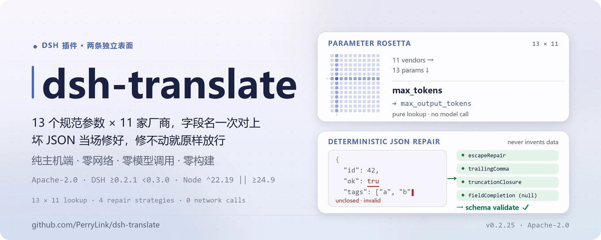
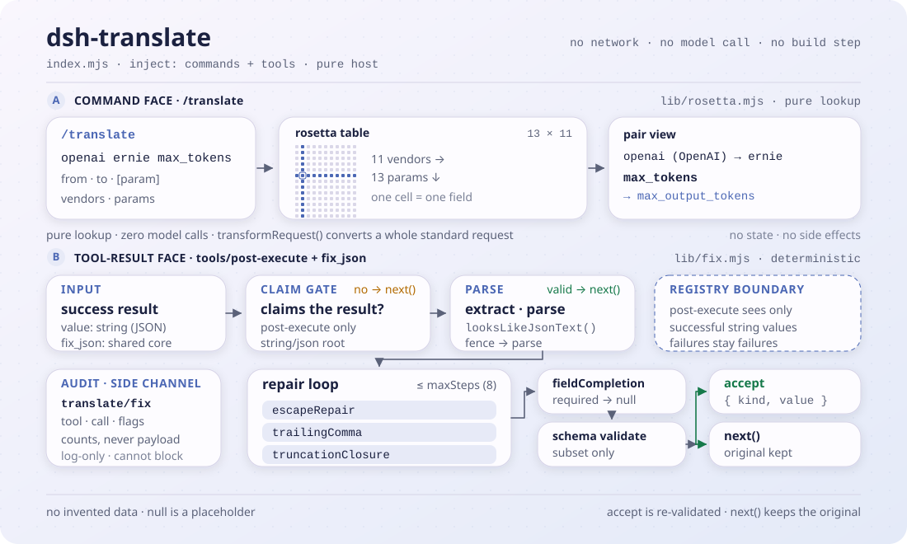

<div align="center">

<picture>
  <source media="(prefers-color-scheme: dark)" srcset="docs/assets/dsh-translate-hero-zh-dark.webp">
  
</picture>

# dsh-translate

**让同一份请求跑通每一家厂商——坏 JSON 当场修好，绝不编造数据。**

面向 DeepSeek Harness 的纯主机端插件：`/translate` 把 13 个规范参数映射到 11 家厂商，`tools/post-execute` 修复层与 `fix_json` 工具把成功工具结果里的坏 JSON 确定性地修到能过 schema 校验。

[安装](#三步上手) · [配置](#配置) · [FAQ](#faq) · [简体中文](README.md) · [English](README.en.md) · [Español](README.es.md) · [Português](README.pt.md) · [हिन्दी](README.hi.md)

[](LICENSE)
[](#兼容性)
[](https://www.npmjs.com/package/dsh-translate)
[](https://github.com/PerryLink/dsh-translate/actions/workflows/ci.yml)
[](#兼容性)

[](https://github.com/PerryLink/dsh-translate/stargazers)
[](https://www.npmjs.com/package/dsh-translate)
[](https://dshfind.com/plugins/PerryLink/dsh-translate?ref=badge)
[](https://securityscorecards.dev/viewer/?uri=github.com/PerryLink/dsh-translate)
[](https://dsh.market/)
[](https://gitee.com/perrylink/dsh-translate)

```sh
dsh plugin --profile <name> add dsh-translate
```

</div>

<sub>社区插件，与 DeepSeek 官方无关。唯一仓库：<https://github.com/PerryLink/dsh-translate>（Gitee 为镜像）。</sub>

## 它是什么

`dsh-translate` 管两件事，彼此独立。第一件是**厂商参数翻译**：把 `temperature`、`top_p`、`max_tokens`、`stop`、`system` 这类规范参数，按 11 家厂商的真实字段名对过去（OpenAI、ERNIE、Qwen、Anthropic、Google、DeepSeek、Mistral、Cohere、xAI、Groq、Azure），既可以用 `/translate openai ernie max_tokens` 查单条，也可以让 `lib/rosetta.mjs` 的 `transformRequest` 整包转换一个标准请求。第二件是**确定性 JSON 修复**：成功的工具结果里如果带着一段坏 JSON，`tools/post-execute` 监听器会先提取围栏、再解析、再跑四种文本策略，直到它能过 schema 校验——修不动就原样放行，绝不编造数值。

名字里的“翻译”指的是厂商参数映射，不是机器翻译。纯主机端、纯 ESM、零构建步骤，`index.mjs` 与 `lib/` 即发布产物。

<picture>
  <source media="(prefers-color-scheme: dark)" srcset="docs/assets/dsh-translate-flow-v5-dark.svg">
  
</picture>

## 三步上手

1. **安装**（三选一）：

   ```sh
   # git 通道（最新 main；等价于 git+https://github.com/PerryLink/dsh-translate.git）
   dsh plugin --profile web add github:PerryLink/dsh-translate
   # npm 通道（已发布版本）
   dsh plugin --profile web add dsh-translate
   # tarball 通道：本仓库 pnpm pack 后
   dsh plugin --profile web add ./dsh-translate-<version>.tgz
   ```

   无构建步骤——`index.mjs` 与 `lib/` 即发布产物。

2. **最小配置**（默认即可用；需要时再动键值）：

   ```yaml
   - insert:
       - id: dsh-translate
         name: dsh-translate
         config:
           enabled: true
           repair:
             enabled: true
           registerCommand: true
           registerTool: true
   ```

3. **验证已生效**：

   ```sh
   dsh --profile web --dump-config | grep -A2 'id: dsh-translate'
   ```

   ```
   > /translate openai ernie max_tokens
   openai (OpenAI) → ernie (Baidu ERNIE (Wenxin)):
     max_tokens: max_tokens → max_output_tokens
   ```

**卸载**：`dsh plugin --profile web remove dsh-translate`（或从 profile patch 删掉该行）。

<details>
<summary>从 DSH Desktop 市场安装</summary>

所有 PerryLink 插件均可在 DSH Desktop 内置市场中浏览：**市场 → 来源 → 添加来源 → 粘贴** `https://perrylink-dsh-catalog.perrylink.workers.dev/catalog-source.json` **→ 选中**。安装仍需通过市场的 npm 身份校验与你的确认。

</details>

## 核心能力

一个 bundle 里两个相互独立的表面：参数翻译表，和事后修复层。

- **`/translate` 参数映射表** —— 13 个规范参数（`temperature`、`top_p`、`max_tokens`、`stop`、`system` 等）对到 **11 家厂商**的真实字段名；可查任意两家的单参数映射、列出厂商/参数，或用 `transformRequest` 整包转换请求。
- **修复层** —— `tools/post-execute` 监听器 + `fix_json` 工具：当成功的工具结果以字符串携带坏 JSON（schema 根为 string 型或无约束 `json` 型，或被 `repair.toolNames` 按名加入）时，按围栏提取、转义修复、去尾逗号、截断闭合、必填字段 `null` 补全的顺序修到能过校验。
- **绝不编造数据** —— `null` 只是占位符，只在 schema 接受 `null` 时落地；修不动的结果原样放行；失败到达的工具结果永不被翻转为成功。
- **审计只记计数** —— `translate/fix` 会话事件只写工具名、call id、策略名、编辑条数与截断标志，绝不记载荷；写入还受宿主事件词汇表门控。
- **敌意输入有界** —— 只认 harness 工具注册表同款的关键字子集，其余关键字按不支持拒绝（而非静默忽略）；循环 schema 与指数级 `oneOf` 被深度与分支预算挡住。

```text
工具结果（成功，JSON 文本）──▶ 提取围栏 ──▶ 解析
    │ 合法? ──▶ schema 校验 ──▶ accept { kind: 'accept', value }（注册表重新校验+重渲染）
    │ 损坏 ──▶ 转义 / 去尾逗号 / 闭合 / null 补全 ──▶ 校验
    │ 无法修复 ──▶ next()（保留原值）+ translate/fix 审计（只记计数）
```

### 命令与工具面

| 表面 | 类型 | 说明 |
|---|---|---|
| `/translate` | 命令 | `vendors`、`params`，或 `<from> <to> [param]` 两两映射 |
| `fix_json` | 工具 | `{ text, schema?, strategies? }` → `{ ok, repaired?, diff?, strategies, truncated, validated, error? }`；diff 片段有界且脱敏 |
| post-execute 修复 | 监听器 | 对 string 根/`json` 根 schema（加 `repair.toolNames`）的成功字符串结果自动生效；不认领时永远 `next()` |

### 示例

以下为插件真实入口；安装后调用一个即可。

**详细示例** —— 命令 `/translate openai ernie max_tokens`：

```text
openai (OpenAI) → ernie (Baidu ERNIE (Wenxin)):
  max_tokens: max_tokens → max_output_tokens
```

*Observed from `README.md:107-110; index.mjs:372-385; test/index.test.mjs:100-105`*

**失败分支** —— 输入 `{"text":"{}","schema":{"pattern":"x"}}`：

```text
fix_json failed (INVALID_SCHEMA): #.pattern is not a supported keyword (subset: type/oneOf/properties/required/additionalProperties/items/enum/const)
```

*Observed from `plugins/dsh-translate/index.mjs:486-488; plugins/dsh-translate/lib/fix.mjs:241; plugins/dsh-translate/test/index.test.mjs:347-352`*

**简短示例**：`fix_json` · `/translate openai ernie max_tokens`

## 配置

所有可调项都是 Schemastery `Config` 字段（可在 cordis.yml 中修改）。按 id 定向覆盖会替换整行——需要重新声明每个键。`cordis.patch.yml` 逐键内联注释。

最常用键：

| 键 | 默认值 | 含义 |
|---|---|---|
| `enabled` | `true` | 总开关；`false` 不注册任何东西 |
| `repair.enabled` | `true` | post-execute 修复层开关 |
| `repair.toolNames` | `[]` | 额外按名加入修复的 JSON 文本工具（叠加于 string 根/`json` 根 schema） |
| `repair.maxSteps` | `8` | 策略应用预算（修复循环轮数，1..64） |
| `diffMaxChars` | `200` | 单条日志 diff 片段的字符上限 |
| `registerCommand` | `true` | 注册 `/translate` 命令 |
| `registerTool` | `true` | 注册 `fix_json` 工具 |

<details>
<summary>完整配置表（13 个键）</summary>

| 键 | 默认值 | 含义 |
|---|---|---|
| `enabled` | `true` | 总开关；`false` 不注册任何东西 |
| `repair.enabled` | `true` | post-execute 修复层开关 |
| `repair.toolNames` | `[]` | 额外按名加入修复的 JSON 文本工具（叠加于 string 根/`json` 根 schema） |
| `repair.strategies.escapeRepair` | `true` | 转义字符串内的裸控制字符 |
| `repair.strategies.trailingComma` | `true` | 删除闭合括号前的逗号 |
| `repair.strategies.truncationClosure` | `true` | 闭合因截断而未闭合的字符串或容器 |
| `repair.strategies.fieldCompletion` | `true` | 以显式 `null` 占位补全缺失的必填字段 |
| `repair.maxSteps` | `8` | 策略应用预算（修复循环轮数，1..64） |
| `diffMaxChars` | `200` | 单条日志 diff 片段的字符上限 |
| `diffMaxEntries` | `50` | 日志 diff 条目上限 |
| `registerCommand` | `true` | 注册 `/translate` 命令 |
| `registerTool` | `true` | 注册 `fix_json` 工具 |
| `rosettaDataPath` | *(none)* | 可选的外部 rosetta 数据文件（与内置 `lib/rosetta-data.json` 同形）；覆盖内置映射表，文件非法则挂载期响亮失败 |

</details>

profile patch 中的覆盖示例：

```yaml
- insert:
    - id: dsh-translate
      name: dsh-translate
      config:
        enabled: true
        repair:
          enabled: true
          toolNames: ['emit-json']
          strategies:
            escapeRepair: true
            trailingComma: true
            truncationClosure: true
            fieldCompletion: true
          maxSteps: 8
        diffMaxChars: 200
        diffMaxEntries: 50
        registerCommand: true
        registerTool: true
```

## FAQ

<details>
<summary>修出来的值是编造的吗？会不会把失败的工具结果改成成功？</summary>

不会。修复只做有界的文本手术：转义修复、去尾逗号、截断闭合、以显式 `null` 占位补全必填字段——`null` 只在 schema 接受 `null` 时落地，否则按 `SCHEMA_VIOLATION` 失败关闭。失败到达的工具结果永远按失败返回；已通过校验的结果也不会被改写。上游的 LLM 重试臂有意未移植，修复路径上没有任何模型调用。

</details>

<details>
<summary>`translate/fix` 审计到底会不会写进会话日志？</summary>

看宿主的事件词汇表。认识 `translate/fix` 的宿主走两参 append 直接写入；带 `ignorable` append 信封的宿主带标记写入；两者都没有的宿主（`0.1.0-rc.6`–`0.1.1-rc.2`、`0.1.2-rc.1`，以及私有类型不在词汇表里的 `0.1.6+`/`0.2.x`）跳过写入。门控只影响可观测性：会话日志永不被污染，修复结果从不依赖审计。

</details>

<details>
<summary>会和其他插件抢 `tools/post-execute` 吗？</summary>

不会。这是 Cordis 的广播事件，每个监听器都会执行，谁也无法饿死别人。本插件只在能交出通过校验的替换值时认领调用，其余路径一律 `next()` 委托，绝不短路链条，也绝不翻转失败结果。

</details>

<details>
<summary>会不会调用模型、联网或读凭据？</summary>

都不会。整个插件无网络、无子进程、无凭据，只消费官方 `commands` 与 `tools` 服务；manifest 的安全面就是这几条。参数映射是纯数据查表，修复是纯函数文本处理。

</details>

<details>
<summary>性能开销多大？巨大的 schema 会不会把进程拖死？</summary>

修复是同步的内存文本处理，预算固定：策略循环最多 `repair.maxSteps` 轮（1..64），`oneOf` 校验受深度（`MAX_ONE_OF_DEPTH`）与分支预算（`MAX_ONE_OF_BUDGET`）限制，diff 片段按 `diffMaxChars`/`diffMaxEntries` 截断。不支持的 schema 关键字与循环 schema 直接拒绝。

</details>

## 安全边界

- **只做确定性修复。** 修复是有界文本手术；JSON-Schema-Enforcer-Proxy 上游的 LLM 重试臂被有意不移植——post-execute 监听器绝不调用模型。
- **失败关闭。** 无法修复的语法与 schema 违例保持原结果不变（或由 `fix_json` 返回结构化错误）；`null` 占位仅在 schema 接受 `null` 时落地。
- **敌意输入有界。** 不支持的 schema 关键字与循环 schema 被拒绝；`oneOf` 校验受深度（`MAX_ONE_OF_DEPTH`）与分支预算（`MAX_ONE_OF_BUDGET`）限制，指数级 schema 无法耗尽进程。
- **载荷零泄漏。** 日志与审计事件绝不包含修复后的载荷；diff 在展示或存储前先截断并限条。

## 权限与数据

- **权限**：无网络、无子进程、无凭据——只消费官方 `commands` 与 `tools` 服务并写会话日志。
- **数据**：修复绝不编造数值；模型可见的增量只有修复后的规范值与 `fix_json` 的 diff。会话审计事件（`translate/fix`）只记工具名、call id、策略名、编辑条数与截断标志——绝不记载荷。审计写入受宿主会话事件词汇表门控：认识 `translate/fix` 的宿主走两参 append；带 `ignorable` append 信封的宿主带标记写入；无信封宿主（`0.1.0-rc.6`–`0.1.1-rc.2`、`0.1.2-rc.1`）与私有类型不在词汇表里的 `0.1.6+`/`0.2.x` 不写审计——工具结果本身仍是模型可见日志。
- **0.1.2-rc.1 会话信封**（2026-09-04 已适配）：保留 ignorable 字段但仅用于存量日志读取兼容——`Session.append` 仍无法盖章，门控行为不变。

## 已知限制

- 支持的 JSON Schema 子集与 harness 工具注册表一致（`type`/`oneOf`/`properties`/`required`/`additionalProperties`/`items`/`enum`/`const`）；其他关键字按不支持拒绝，而非静默忽略。
- 修复只作用于规范值为 JSON 文本字符串的成功结果；已因 schema 校验失败的结果按失败到达，绝不翻转。
- 翻译表覆盖 11 家厂商 × 13 个规范参数；`extended` 行按公开 API 参考扩展（非上游三家），并在 `lib/rosetta.mjs` 中标注。
- 在既不认识 `translate/fix`、又没有 `ignorable` 信封的宿主上（已发布 `0.1.0-rc.6`–`0.1.1-rc.2` 线，以及读取时对未知事件类型 fail-closed 的 `0.1.2-rc.1`；`0.1.6+`/`0.2.x` 的私有类型词汇表同样不含它），自适应门跳过审计写入，会话日志永不被污染；这些宿主在收录该事件类型前没有 in-log 审计镜像。

## 与其他 DSH 插件的互操作性

已对照 **DSH `0.2.0-rc.2`**（本 README 面向的运行时）与 2026-10-05 实测的高星插件集验证。

本插件**不干扰**其他插件，包括广泛安装的高星插件：

- **无工具名冲突。** 所有工具都带命名空间，不占用任何已被内置工具或其他插件持有的裸名。
- **无服务键冲突。** 不提供任何服务键，因此不存在服务键冲突。
- **无 slot 冲突。** 不注册客户端 slot key，因此不参与 `shadows-shipped-ui` 座位争抢。
- **无 HTTP 路由冲突。** 不注册任何 `webServer` 前缀。
- **无 patch 层冲突。** 组合包 patch 只 `insert` 自己那一行，从不覆写内置行的 `config`。
- **无全局改写。** 不改原型、不改写 `process.env`、不替换全局 fetch dispatcher。

**共享事件监听器在构造上就不互相干扰。** 它用 `ctx.on()` 监听顺序敏感事件 `tools/post-execute`——Cordis 的**广播**语义：每个监听器都会运行，任何一个都无法饿死其他监听器。**此处每个监听器都通过 `next()` 委托**，因此链条绝不会被短路；改写作用在 `next()` 产出的值上，而不是用它顶替返回：

- `tools/post-execute` — also used by `cc-safety-net` (1576★).

静态证据：`dsh-plugin-doctor` 的 K10–K13 在本仓全部为 `pass`。

## 兼容性

| 维度 | 状态 |
|---|---|
| Harness | 主版本 **`dsh-v0.2.1-alpha.1`**（2026-09-24 核验：双 typecheck 尺子 + `node --test` 80/80 + self-contained/artifacts 门）。`engines.dsh` = `>=0.2.1-0 <0.3.0 \|\| >=0.2.2-0 <0.3.0`；npm dev/test 钉号 `0.2.2-rc.1`。 |
| Node | `^22.19.0 \|\| >=24.9.0` |
| 形态 | 纯 host JS 插件（无浏览器半、无构建步骤） |
| 模型 | 任意模型——修复完全确定性，不增加模型调用 |

## 生态与质量

- [Gitee 镜像](https://gitee.com/perrylink/dsh-translate)（同步镜像，以 GitHub 为准）
- [dshfind 插件页](https://dshfind.com/plugins/PerryLink/dsh-translate)（安装量与排名）
- [OpenSSF Scorecard 报告](https://securityscorecards.dev/viewer/?uri=github.com/PerryLink/dsh-translate)（由 [.github/workflows/scorecard.yml](.github/workflows/scorecard.yml) 驱动）
- [dsh-plugin-doctor 验证报告](https://github.com/PerryLink/dsh-plugin-doctor#verified-徽章)（K10–K13 全 `pass`）
- [DSH Market](https://dsh.market/)（已上架）
- **1024 商店渠道**：先 `npm i -g dsh1024`，再 `dsh1024 plugin --profile web add dsh-translate`（计入 [deepseek1024.com](https://deepseek1024.com) 安装排行）
- [生态实测知识库](https://perrylink.github.io/dsh-plugin-guide/)：插件开发指南 · 选型实测数据 · 维护取舍判据

## 开发

```sh
pnpm install                    # node ^22.19 || >=24.9
pnpm test                       # node --test：79 个测试（纯函数套件 + 真实服务装配套件）
pnpm run check                  # tsc checkJs，对照 types.d.ts
pnpm run verify:self-contained  # 依赖声明全部来自 registry
pnpm run verify:artifacts       # 纯 Node 下 ESM 面可 import + lib 导出齐全
node scripts/check-readme-sync.mjs  # 五语 README 同步门（CI 同样执行）
pnpm pack                       # 发布用 tarball
```

无构建步骤：纯 ESM，`index.mjs` 与 `lib/` 即发布产物。配图由 [`scripts/gen-readme-assets.py`](scripts/gen-readme-assets.py) 程序化生成（Pillow 绘制 hero，手写 SVG 绘制结构图），可重复执行：`python scripts/gen-readme-assets.py`，产出 `docs/assets/dsh-translate-hero-{zh,en}-{light,dark}.webp` 与 `docs/assets/dsh-translate-flow-v5-{light,dark}.svg`。

Topics：`dsh`, `dsh-plugin`, `deepseek-harness`, `deepseek`, `cordis`, `json-repair`, `schema-validation`, `parameter-mapping`, `llm-api`, `tooling`

## 家族与致谢

本项目是 [PerryLink](https://github.com/PerryLink) 维护的 DeepSeek Harness 插件家族成员（全部 Apache-2.0）。如果这个插件帮到了你，**给个 star**——它不解锁任何功能，但会让下一个人更容易找到它。

- [@PerryLink](https://github.com/PerryLink) —— 创建者与维护者：翻译表与修复管线移植、插件表面、测试与五语文档。

<details>
<summary>展开全部插件</summary>

| 插件 | 状态 |
|---|---|
| **[dsh-aqua-input-check](https://github.com/PerryLink/dsh-aqua-input-check)** |  |
| **[dsh-archive-check](https://github.com/PerryLink/dsh-archive-check)** |  |
| **[dsh-auto-review](https://github.com/PerryLink/dsh-auto-review)** |  |
| **[dsh-autotier](https://github.com/PerryLink/dsh-autotier)** | 🧊 已冻结 — 见仓库 README |
| **[dsh-bid-ca-precheck](https://github.com/PerryLink/dsh-bid-ca-precheck)** |  |
| **[dsh-bid-qual-check](https://github.com/PerryLink/dsh-bid-qual-check)** |  |
| **[dsh-cert-mcp](https://github.com/PerryLink/dsh-cert-mcp)** | 🧊 已冻结 — 见仓库 README |
| **[dsh-checkpoint-rewind](https://github.com/PerryLink/dsh-checkpoint-rewind)** |  |
| **[dsh-click](https://github.com/PerryLink/dsh-click)** |  |
| **[dsh-composer-history](https://github.com/PerryLink/dsh-composer-history)** |  |
| **[dsh-contract-stance](https://github.com/PerryLink/dsh-contract-stance)** |  |
| **[dsh-customs-doc-check](https://github.com/PerryLink/dsh-customs-doc-check)** |  |
| **[dsh-data-quality](https://github.com/PerryLink/dsh-data-quality)** | 🧊 已冻结 — 见仓库 README |
| **[dsh-demurrage-ledger](https://github.com/PerryLink/dsh-demurrage-ledger)** |  |
| **[dsh-doublecheck](https://github.com/PerryLink/dsh-doublecheck)** |  |
| **[dsh-drill-script-check](https://github.com/PerryLink/dsh-drill-script-check)** |  |
| **[dsh-eia-guide-check](https://github.com/PerryLink/dsh-eia-guide-check)** |  |
| **[dsh-emergency-plan](https://github.com/PerryLink/dsh-emergency-plan)** |  |
| **[dsh-essay-rubric-check](https://github.com/PerryLink/dsh-essay-rubric-check)** |  |
| **[dsh-evidence-check](https://github.com/PerryLink/dsh-evidence-check)** |  |
| **[dsh-export-ctl-check](https://github.com/PerryLink/dsh-export-ctl-check)** |  |
| **[dsh-fast](https://github.com/PerryLink/dsh-fast)** |  |
| **[dsh-fmea-table-check](https://github.com/PerryLink/dsh-fmea-table-check)** |  |
| **[dsh-forecast-penalty](https://github.com/PerryLink/dsh-forecast-penalty)** |  |
| **[dsh-fund-research](https://github.com/PerryLink/dsh-fund-research)** |  |
| **[dsh-github](https://github.com/PerryLink/dsh-github)** |  |
| **[dsh-gongwen-flow-check](https://github.com/PerryLink/dsh-gongwen-flow-check)** |  |
| **[dsh-gongwen-word-check](https://github.com/PerryLink/dsh-gongwen-word-check)** |  |
| **[dsh-guard-plan-qc](https://github.com/PerryLink/dsh-guard-plan-qc)** |  |
| **[dsh-hazchem-check](https://github.com/PerryLink/dsh-hazchem-check)** |  |
| **[dsh-hazplan-check](https://github.com/PerryLink/dsh-hazplan-check)** |  |
| **[dsh-hidden-risk-map](https://github.com/PerryLink/dsh-hidden-risk-map)** |  |
| **[dsh-hs-classify](https://github.com/PerryLink/dsh-hs-classify)** |  |
| **[dsh-icd-rule-check](https://github.com/PerryLink/dsh-icd-rule-check)** |  |
| **[dsh-industry-research](https://github.com/PerryLink/dsh-industry-research)** |  |
| **[dsh-lawcite-adapter](https://github.com/PerryLink/dsh-lawcite-adapter)** |  |
| **[dsh-laya](https://github.com/PerryLink/dsh-laya)** |  |
| **[dsh-lc-doc-check](https://github.com/PerryLink/dsh-lc-doc-check)** |  |
| **[dsh-learning-gap-check](https://github.com/PerryLink/dsh-learning-gap-check)** |  |
| **[dsh-library](https://github.com/PerryLink/dsh-library)** |  |
| **[dsh-local-ai](https://github.com/PerryLink/dsh-local-ai)** |  |
| **[dsh-lsp-actions](https://github.com/PerryLink/dsh-lsp-actions)** |  |
| **[dsh-mask](https://github.com/PerryLink/dsh-mask)** |  |
| **[dsh-mcp-panel](https://github.com/PerryLink/dsh-mcp-panel)** |  |
| **[dsh-medrec-qc](https://github.com/PerryLink/dsh-medrec-qc)** |  |
| **[dsh-memento](https://github.com/PerryLink/dsh-memento)** | 🧊 已冻结 — 见仓库 README |
| **[dsh-nsfc-form-check](https://github.com/PerryLink/dsh-nsfc-form-check)** |  |
| **[dsh-nurse-record-check](https://github.com/PerryLink/dsh-nurse-record-check)** |  |
| **[dsh-observe](https://github.com/PerryLink/dsh-observe)** |  |
| **[dsh-origin-rvc-check](https://github.com/PerryLink/dsh-origin-rvc-check)** |  |
| **[dsh-ota-review-check](https://github.com/PerryLink/dsh-ota-review-check)** |  |
| **[dsh-output-styles](https://github.com/PerryLink/dsh-output-styles)** |  |
| **[dsh-paper-doc-adapter](https://github.com/PerryLink/dsh-paper-doc-adapter)** |  |
| **[dsh-permission-rules](https://github.com/PerryLink/dsh-permission-rules)** |  |
| **[dsh-permit-report-check](https://github.com/PerryLink/dsh-permit-report-check)** |  |
| **[dsh-pipeline-check](https://github.com/PerryLink/dsh-pipeline-check)** |  |
| **[dsh-pleading-draft](https://github.com/PerryLink/dsh-pleading-draft)** |  |
| **[dsh-plugin-doctor](https://github.com/PerryLink/dsh-plugin-doctor)** | 🚫 已退役（仓库已归档） |
| **[dsh-plugin-guide](https://github.com/PerryLink/dsh-plugin-guide)** |  |
| **[dsh-plugin-kit](https://github.com/PerryLink/dsh-plugin-kit)** | 🚫 已退役（仓库已归档） |
| **[dsh-plugin-upgrade](https://github.com/PerryLink/dsh-plugin-upgrade)** | 🚫 已退役（仓库已归档） |
| **[dsh-policy-brief-draft](https://github.com/PerryLink/dsh-policy-brief-draft)** |  |
| **[dsh-power-loss-split](https://github.com/PerryLink/dsh-power-loss-split)** |  |
| **[dsh-power-ticket-check](https://github.com/PerryLink/dsh-power-ticket-check)** |  |
| **[dsh-ppap-check](https://github.com/PerryLink/dsh-ppap-check)** |  |
| **[dsh-protest-deadline](https://github.com/PerryLink/dsh-protest-deadline)** |  |
| **[dsh-railway-window](https://github.com/PerryLink/dsh-railway-window)** |  |
| **[dsh-repair-order-qc](https://github.com/PerryLink/dsh-repair-order-qc)** |  |
| **[dsh-research-report](https://github.com/PerryLink/dsh-research-report)** |  |
| **[dsh-review-reply-check](https://github.com/PerryLink/dsh-review-reply-check)** |  |
| **[dsh-rulefile-check](https://github.com/PerryLink/dsh-rulefile-check)** |  |
| **[dsh-safety-brief-check](https://github.com/PerryLink/dsh-safety-brief-check)** |  |
| **[dsh-score](https://github.com/PerryLink/dsh-score)** | 🧊 已冻结 — 见仓库 README |
| **[dsh-session-sync](https://github.com/PerryLink/dsh-session-sync)** |  |
| **[dsh-site-log-check](https://github.com/PerryLink/dsh-site-log-check)** |  |
| **[dsh-skill-pack-security](https://github.com/PerryLink/dsh-skill-pack-security)** |  |
| **[dsh-soe-decision-check](https://github.com/PerryLink/dsh-soe-decision-check)** |  |
| **[dsh-soilwater-check](https://github.com/PerryLink/dsh-soilwater-check)** |  |
| **[dsh-sop-sync-check](https://github.com/PerryLink/dsh-sop-sync-check)** |  |
| **[dsh-spc-gbt-adapter](https://github.com/PerryLink/dsh-spc-gbt-adapter)** |  |
| **[dsh-talk](https://github.com/PerryLink/dsh-talk)** |  |
| **[dsh-tender-extract](https://github.com/PerryLink/dsh-tender-extract)** |  |
| **[dsh-tender-matrix](https://github.com/PerryLink/dsh-tender-matrix)** |  |
| **[dsh-test-drive](https://github.com/PerryLink/dsh-test-drive)** |  |
| **[dsh-ticktick](https://github.com/PerryLink/dsh-ticktick)** | 🚫 已退役（仓库已归档） |
| **[dsh-translate](https://github.com/PerryLink/dsh-translate)** |  |
| **[dsh-warranty-calc](https://github.com/PerryLink/dsh-warranty-calc)** |  |
| **[dsh-budget](https://github.com/PerryLink/dsh-budget)** |  |
| **[dsh-claude-move](https://github.com/PerryLink/dsh-claude-move)** |  |
| **[dsh-defend](https://github.com/PerryLink/dsh-defend)** |  |
| **[dsh-draw](https://github.com/PerryLink/dsh-draw)** | 🧊 已冻结 — 见仓库 README |
| **[dsh-reach](https://github.com/PerryLink/dsh-reach)** |  |
| **[dsh-background-agents](https://github.com/PerryLink/dsh-background-agents)** | 🚫 已退役（仓库已归档） |
| **[dsh-session-pin](https://github.com/PerryLink/dsh-session-pin)** | 🚫 已退役（仓库已归档） |
| **[dsh-team-rooms](https://github.com/PerryLink/dsh-team-rooms)** | 🚫 已退役（仓库已归档） |

</details>

## License

[LICENSE](LICENSE)（Apache License 2.0）© 2026 dsh-translate contributors

<p align="center"><sub>Apache-2.0 · 社区插件，与 DeepSeek 无关。</sub></p>
