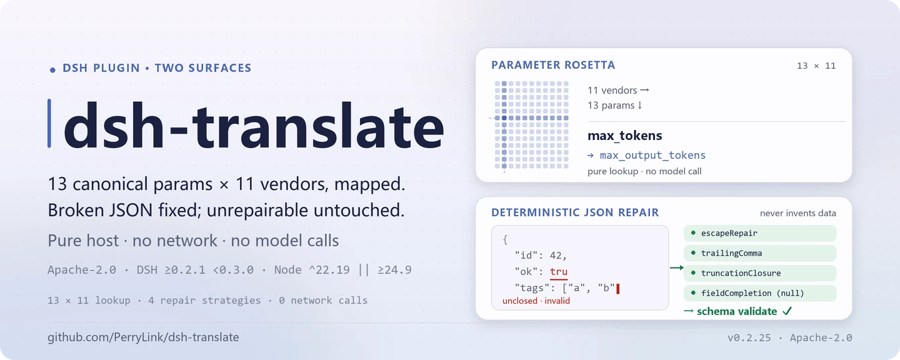
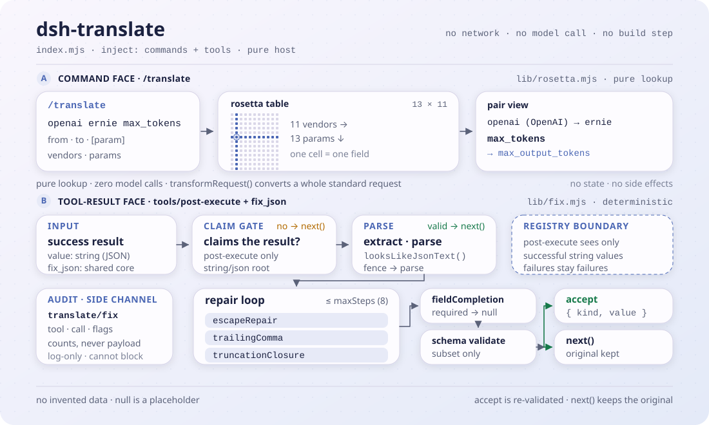

<div align="center">

<picture>
  <source media="(prefers-color-scheme: dark)" srcset="docs/assets/dsh-translate-hero-en-dark.webp">
  
</picture>

# dsh-translate

**Faça a mesma requisição funcionar em todos os provedores: o JSON quebrado é corrigido na hora, nunca inventando dados.**

Um plugin puramente host-side para o DeepSeek Harness: o `/translate` mapeia 13 parâmetros canônicos em 11 provedores, e a camada de reparo de `tools/post-execute` mais a ferramenta `fix_json` reparam de forma determinística o JSON quebrado dos resultados bem-sucedidos até ele passar na validação de schema.

[Instalar](#instalação-em-três-passos) · [Configuração](#configuração) · [FAQ](#faq) · [简体中文](README.md) · [English](README.en.md) · [Español](README.es.md) · [Português](README.pt.md) · [हिन्दी](README.hi.md)

[](LICENSE)
[](#compatibilidade)
[](https://www.npmjs.com/package/dsh-translate)
[](https://github.com/PerryLink/dsh-translate/actions/workflows/ci.yml)
[](#compatibilidade)

[](https://github.com/PerryLink/dsh-translate/stargazers)
[](https://www.npmjs.com/package/dsh-translate)
[](https://dshfind.com/plugins/PerryLink/dsh-translate?ref=badge)
[](https://securityscorecards.dev/viewer/?uri=github.com/PerryLink/dsh-translate)
[](https://dsh.market/)
[](https://gitee.com/perrylink/dsh-translate)

```sh
dsh plugin --profile <name> add dsh-translate
```

</div>

<sub>Plugin da comunidade, sem afiliação com a DeepSeek. Repositório canônico: <https://github.com/PerryLink/dsh-translate> (o Gitee é um espelho).</sub>

## O que é

O `dsh-translate` faz duas coisas independentes. A primeira é a **tradução de parâmetros entre provedores**: parâmetros canônicos como `temperature`, `top_p`, `max_tokens`, `stop` e `system` são mapeados para os nomes de campo reais de 11 provedores (OpenAI, ERNIE, Qwen, Anthropic, Google, DeepSeek, Mistral, Cohere, xAI, Groq, Azure); consulte um mapeamento com `/translate openai ernie max_tokens` ou converta uma requisição padrão inteira com `transformRequest` de `lib/rosetta.mjs`. A segunda é o **reparo determinístico de JSON**: quando um resultado de ferramenta bem-sucedido carrega JSON quebrado como texto, o listener de `tools/post-execute` extrai o bloco, analisa e aplica quatro estratégias de texto até a carga passar na validação de schema; se não for reparável, o valor original segue intacto e nenhum dado é inventado.

O "translate" do nome é uma tabela de correspondência de parâmetros, não tradução automática. Host puro, ESM puro, sem etapa de build: `index.mjs` e `lib/` são o artefato publicado.

<picture>
  <source media="(prefers-color-scheme: dark)" srcset="docs/assets/dsh-translate-flow-v5-dark.svg">
  
</picture>

## Instalação em três passos

1. **Instalar** (escolha uma via):

   ```sh
   # canal git (último main; equivale a git+https://github.com/PerryLink/dsh-translate.git)
   dsh plugin --profile web add github:PerryLink/dsh-translate
   # canal npm (versões publicadas)
   dsh plugin --profile web add dsh-translate
   # canal tarball: após pnpm pack neste repositório
   dsh plugin --profile web add ./dsh-translate-<version>.tgz
   ```

   Sem etapa de build: `index.mjs` e `lib/` são o artefato publicado.

2. **Configuração mínima** (os padrões já funcionam; mexa nas chaves só se precisar):

   ```yaml
   - insert:
       - id: dsh-translate
         name: dsh-translate
         config:
           enabled: true
           repair:
             enabled: true
           registerCommand: true
           registerTool: true
   ```

3. **Verificar que está ativo**:

   ```sh
   dsh --profile web --dump-config | grep -A2 'id: dsh-translate'
   ```

   ```
   > /translate openai ernie max_tokens
   openai (OpenAI) → ernie (Baidu ERNIE (Wenxin)):
     max_tokens: max_tokens → max_output_tokens
   ```

**Desinstalar**: `dsh plugin --profile web remove dsh-translate` (ou remova a linha do patch do perfil).

<details>
<summary>Instalar pelo mercado do DSH Desktop</summary>

Todos os plugins PerryLink podem ser explorados no mercado embutido do DSH Desktop: **Mercado → Fontes → Adicionar fonte → colar** `https://perrylink-dsh-catalog.perrylink.workers.dev/catalog-source.json` **→ selecionar**. A instalação continua passando pela verificação de identidade npm do mercado e pela sua confirmação.

</details>

## Capacidades principais

Duas superfícies independentes em um único bundle: a tabela de tradução de parâmetros e a camada de reparo posterior.

- **Mapa de parâmetros `/translate`** — 13 parâmetros canônicos (`temperature`, `top_p`, `max_tokens`, `stop`, `system` e mais 8) mapeados para os nomes de campo reais de **11 provedores**; consulte qualquer correspondência de um parâmetro entre dois provedores, liste provedores/parâmetros ou converta uma requisição inteira com `transformRequest`.
- **Camada de reparo** — um listener de `tools/post-execute` mais a ferramenta `fix_json`: quando um resultado bem-sucedido carrega JSON quebrado como texto (schema de saída com raiz string ou `json`, ou ativado por `repair.toolNames`), ele repara por extração de bloco, reparo de escapes, remoção de vírgulas finais, fechamento por truncamento e preenchimento de campos obrigatórios com `null` até a carga validar.
- **Nunca inventa dados** — `null` é só um marcador e só entra quando o schema aceita `null`; um resultado que não pode ser reparado segue intacto; um resultado com falha nunca vira sucesso.
- **Auditoria só com contagens** — o evento de sessão `translate/fix` registra nome da ferramenta, call id, nomes de estratégia, número de edições e sinalizações de truncamento, nunca cargas; a escrita ainda é condicionada pelo vocabulário de eventos do host.
- **Entrada hostil limitada** — só é aceito o subconjunto de palavras-chave suportado pelo registro de ferramentas do harness; as demais são rejeitadas como não suportadas em vez de ignoradas em silêncio; schemas circulares e `oneOf` exponenciais batem nos limites de profundidade e de ramos.

```text
resultado de ferramenta (sucesso, texto JSON) ──▶ extrair bloco ──▶ analisar
    │ válido? ──▶ validar schema ──▶ accept { kind: 'accept', value }  (o registro revalida e renderiza de novo)
    │ quebrado ──▶ escape / vírgula final / fechamento / preenchimento null ──▶ validar
    │ irreparável ──▶ next()  (valor original preservado) + auditoria translate/fix (só contagens)
```

### Superfície de comandos e ferramentas

| Superfície | Tipo | Notas |
|---|---|---|
| `/translate` | comando | `vendors`, `params`, ou mapeamento por par `<from> <to> [param]` |
| `fix_json` | ferramenta | `{ text, schema?, strategies? }` → `{ ok, repaired?, diff?, strategies, truncated, validated, error? }`; fragmentos de diff são limitados e sanitizados |
| reparo post-execute | listener | Automático para resultados string bem-sucedidos de schemas com raiz string / `json` (mais `repair.toolNames`); sempre chama `next()` a menos que assuma a chamada |

### Exemplos

Estes são os pontos de entrada reais do plugin; instale uma vez e chame um.

**Exemplo detalhado** — comando `/translate openai ernie max_tokens`:

```text
openai (OpenAI) → ernie (Baidu ERNIE (Wenxin)):
  max_tokens: max_tokens → max_output_tokens
```

*Observed from `README.md:107-110; index.mjs:372-385; test/index.test.mjs:100-105`*

**Ramo de falha** — entrada `{"text":"{}","schema":{"pattern":"x"}}`:

```text
fix_json failed (INVALID_SCHEMA): #.pattern is not a supported keyword (subset: type/oneOf/properties/required/additionalProperties/items/enum/const)
```

*Observed from `plugins/dsh-translate/index.mjs:486-488; plugins/dsh-translate/lib/fix.mjs:241; plugins/dsh-translate/test/index.test.mjs:347-352`*

**Exemplos curtos**: `fix_json` · `/translate openai ernie max_tokens`

## Configuração

Todas as opções são campos `Config` do Schemastery (alteráveis no cordis.yml). Uma sobrescrita por id substitui a linha inteira: redeclare todas as chaves de que precisa. O `cordis.patch.yml` documenta cada chave em linha.

Chaves mais usadas:

| Chave | Padrão | Significado |
|---|---|---|
| `enabled` | `true` | Interruptor geral; `false` não registra nada |
| `repair.enabled` | `true` | Interruptor da camada de reparo post-execute |
| `repair.toolNames` | `[]` | Nomes extras de ferramentas cujos resultados de texto JSON podem ser reparados (além dos schemas com raiz string / `json`) |
| `repair.maxSteps` | `8` | Orçamento de aplicação de estratégias (passadas do laço de reparo, 1..64) |
| `diffMaxChars` | `200` | Teto de caracteres de um fragmento de diff registrado |
| `registerCommand` | `true` | Registra o comando `/translate` |
| `registerTool` | `true` | Registra a ferramenta `fix_json` |

<details>
<summary>Tabela de configuração completa (13 chaves)</summary>

| Chave | Padrão | Significado |
|---|---|---|
| `enabled` | `true` | Interruptor geral; `false` não registra nada |
| `repair.enabled` | `true` | Interruptor da camada de reparo post-execute |
| `repair.toolNames` | `[]` | Nomes extras de ferramentas cujos resultados de texto JSON podem ser reparados (além dos schemas com raiz string / `json`) |
| `repair.strategies.escapeRepair` | `true` | Escapa caracteres de controle crus dentro de strings |
| `repair.strategies.trailingComma` | `true` | Remove vírgulas logo antes de um fechamento |
| `repair.strategies.truncationClosure` | `true` | Fecha uma string ou contêiner deixado aberto por truncamento |
| `repair.strategies.fieldCompletion` | `true` | Completa campos obrigatórios ausentes com marcadores `null` explícitos |
| `repair.maxSteps` | `8` | Orçamento de aplicação de estratégias (passadas do laço de reparo, 1..64) |
| `diffMaxChars` | `200` | Teto de caracteres de um fragmento de diff registrado |
| `diffMaxEntries` | `50` | Teto de entradas de diff registradas |
| `registerCommand` | `true` | Registra o comando `/translate` |
| `registerTool` | `true` | Registra a ferramenta `fix_json` |
| `rosettaDataPath` | *(none)* | Arquivo de dados rosetta externo opcional (mesma forma do `lib/rosetta-data.json` embutido); substitui a tabela integrada, e um arquivo inválido derruba a montagem de forma ruidosa |

</details>

Exemplo de sobrescrita no patch do perfil:

```yaml
- insert:
    - id: dsh-translate
      name: dsh-translate
      config:
        enabled: true
        repair:
          enabled: true
          toolNames: ['emit-json']
          strategies:
            escapeRepair: true
            trailingComma: true
            truncationClosure: true
            fieldCompletion: true
          maxSteps: 8
        diffMaxChars: 200
        diffMaxEntries: 50
        registerCommand: true
        registerTool: true
```

## FAQ

<details>
<summary>Os valores reparados são inventados? Um resultado com falha pode virar sucesso?</summary>

Não. O reparo é cirurgia de texto limitada: reparo de escapes, remoção de vírgulas finais, fechamento por truncamento e preenchimento de campos obrigatórios com `null`; `null` só entra quando o schema aceita `null`, e caso contrário o reparo falha fechado com `SCHEMA_VIOLATION`. Resultados com falha sempre chegam como falha; um resultado já válido nunca é reescrito. O ramo de nova tentativa com LLM do projeto original não foi portado de propósito, então não há nenhuma chamada a modelo no caminho de reparo.

</details>

<details>
<summary>O evento de auditoria `translate/fix` chega mesmo ao registro de sessão?</summary>

Depende do vocabulário de eventos do host. Um host que conhece `translate/fix` recebe o append simples de dois argumentos; um host com o envelope `ignorable` recebe o append marcado; hosts sem nenhum dos dois (`0.1.0-rc.6`–`0.1.1-rc.2`, `0.1.2-rc.1` e `0.1.6+`/`0.2.x`, cujo vocabulário de tipos privados não o contém) não recebem append. O portão afeta apenas a observabilidade: o registro de sessão nunca é poluído e o resultado do reparo nunca depende da auditoria.

</details>

<details>
<summary>Ele disputa `tools/post-execute` com outros plugins?</summary>

Não. Esse é um evento de broadcast do Cordis: todos os listeners rodam e nenhum pode deixar outro sem vez. Este plugin só assume uma chamada quando pode devolver um substituto que já validou; qualquer outro caminho delega via `next()`, então a cadeia nunca é curto-circuitada e uma falha nunca é invertida.

</details>

<details>
<summary>Ele chama modelo, usa rede ou lê credenciais?</summary>

Não. O plugin não tem rede, subprocessos nem credenciais: só consome os serviços oficiais `commands` e `tools`. A tradução de parâmetros é consulta de dados pura; o reparo é processamento de texto determinístico.

</details>

<details>
<summary>Qual é o custo em execução? Um schema enorme pode travar o processo?</summary>

O reparo é processamento de texto em memória e síncrono, com orçamentos fixos: o laço de estratégias faz no máximo `repair.maxSteps` passadas (1..64), a validação `oneOf` é limitada por profundidade (`MAX_ONE_OF_DEPTH`) e por um orçamento de ramos (`MAX_ONE_OF_BUDGET`), e os diffs são truncados por `diffMaxChars`/`diffMaxEntries`. Palavras-chave de schema não suportadas e schemas circulares são rejeitados na hora.

</details>

## Limites de segurança

- **Somente determinístico.** O reparo é cirurgia de texto limitada; o ramo de nova tentativa com LLM do JSON-Schema-Enforcer-Proxy não foi portado de propósito — um listener post-execute nunca chama um modelo.
- **Falha fechada.** Violações de sintaxe e de schema não reparáveis deixam o resultado original intacto (ou devolvem um erro estruturado do `fix_json`); marcadores `null` só entram quando o schema aceita `null`.
- **Entrada hostil limitada.** Palavras-chave de schema não suportadas e schemas circulares são rejeitados; a validação `oneOf` é limitada por profundidade (`MAX_ONE_OF_DEPTH`) e por um orçamento de ramos (`MAX_ONE_OF_BUDGET`), então um schema exponencial não consegue esgotar o processo.
- **Sem vazamento de cargas.** Registros e eventos de auditoria nunca contêm cargas reparadas; os diffs são truncados e limitados antes de serem exibidos ou armazenados.

## Permissões e dados

- **Permissões**: sem rede, sem subprocessos, sem credenciais — o plugin só consome os serviços oficiais `commands` e `tools` e escreve no registro de sessão.
- **Dados**: o reparo nunca inventa valores; as únicas adições visíveis ao modelo são o valor canônico reparado e o diff do `fix_json`. Eventos de auditoria de sessão (`translate/fix`) carregam nome da ferramenta, call id, nomes de estratégia, número de edições e sinalizações de truncamento, nunca cargas. A escrita de auditoria é condicionada pelo vocabulário de eventos do host: um host que conhece `translate/fix` recebe o append simples de dois argumentos, um host com o envelope `ignorable` recebe o append marcado, e hosts sem envelope (`0.1.0-rc.6`–`0.1.1-rc.2`, `0.1.2-rc.1`) mais `0.1.6+`/`0.2.x` (tipo privado ausente do vocabulário) não recebem append — o resultado da ferramenta continua sendo o registro visível ao modelo.
- **Envelope de sessão do `0.1.2-rc.1`** (adaptado em 2026-09-04): o envelope mantém o campo ignorable apenas para ler registros existentes; o `Session.append` continua sem conseguir carimbá-lo, então o portão se comporta igual.

## Limitações conhecidas

- O subconjunto de JSON Schema suportado espelha o registro de ferramentas do harness (`type`/`oneOf`/`properties`/`required`/`additionalProperties`/`items`/`enum`/`const`); as demais palavras-chave são rejeitadas como não suportadas, não ignoradas em silêncio.
- O reparo só se aplica a resultados bem-sucedidos cujo valor canônico é uma string com texto JSON; um valor que já falhou na validação de schema chega como resultado com falha e nunca é invertido.
- A tabela de tradução cobre 11 provedores × 13 parâmetros canônicos; as linhas `extended` seguem referências públicas de API (não o trio do upstream) e são marcadas como tal em `lib/rosetta.mjs`.
- Em hosts que não conhecem `translate/fix` nem expõem o envelope de append `ignorable` — a linha publicada `0.1.0-rc.6`–`0.1.1-rc.2`, o `0.1.2-rc.1` (falha fechada em tipos de evento desconhecidos na leitura) e os `0.1.6+`/`0.2.x`, cujo vocabulário de tipos privados não o contém — o portão adaptativo pula o append de auditoria para o registro de sessão nunca ser poluído; o resultado da ferramenta continua sendo a evidência durável até o tipo de evento ser registrado.

## Interoperabilidade com outros plugins DSH

Verificado contra o **DSH `0.2.0-rc.2`** (o runtime para o qual este README aponta) e o conjunto de plugins com mais estrelas medido em 2026-10-05.

Este plugin **não interfere** em outros plugins, incluindo os de mais estrelas e amplamente instalados:

- **Sem colisão de nome de ferramenta.** Toda ferramenta tem namespace; nenhum nome nu pertencente a uma ferramenta embutida ou a outro plugin é registrado.
- **Sem colisão de chave de serviço.** Não oferece nenhuma chave de serviço, então não pode colidir em uma.
- **Sem colisão de slot.** Não registra nenhuma chave de slot de cliente, então não disputa um assento de `shadows-shipped-ui`.
- **Sem colisão de rota HTTP.** Não registra nenhum prefixo de `webServer`.
- **Sem colisão de camada de patch.** O patch do bundle só `insert`a a própria linha; nunca sobrescreve o `config` de uma linha embutida.
- **Sem mutação global.** Não altera protótipos, não reescreve `process.env` nem substitui o dispatcher fetch global.

**Listeners de eventos compartilhados não interferem por construção.** Ele observa o evento sensível a ordem `tools/post-execute` com `ctx.on()` — o registro de broadcast do Cordis, em que todos os listeners rodam e nenhum pode deixar outro sem vez. **Cada listener aqui delega via `next()`**, então a cadeia nunca é curto-circuitada, e uma mutação é aplicada ao valor que o `next()` produziu em vez de substituí-lo:

- `tools/post-execute` — also used by `cc-safety-net` (1576★).

Evidência estática: o `dsh-plugin-doctor` K10–K13 reporta `pass` em todas as verificações deste repositório.

## Compatibilidade

| Superfície | Estado |
|---|---|
| Harness | Versão principal **`dsh-v0.2.1-alpha.1`** (verificado em 2026-09-24: régua dupla de typecheck + `node --test` 80/80 + portões self-contained/artifacts). `engines.dsh` = `>=0.2.1-0 <0.3.0 \|\| >=0.2.2-0 <0.3.0`; pinos npm dev/test `0.2.2-rc.1`. |
| Node | `^22.19.0 \|\| >=24.9.0` |
| Forma | Plugin JS puramente host (sem metade de navegador, sem etapa de build) |
| Modelo | Qualquer modelo — o reparo é totalmente determinístico e não adiciona chamadas ao modelo |

## Ecossistema e qualidade

- [Espelho no Gitee](https://gitee.com/perrylink/dsh-translate) (espelho sincronizado; o GitHub continua canônico)
- [Página no dshfind](https://dshfind.com/plugins/PerryLink/dsh-translate) (instalações e ranking)
- [Relatório OpenSSF Scorecard](https://securityscorecards.dev/viewer/?uri=github.com/PerryLink/dsh-translate) (gerado por [.github/workflows/scorecard.yml](.github/workflows/scorecard.yml))
- [Relatório de verificação do dsh-plugin-doctor](https://github.com/PerryLink/dsh-plugin-doctor#verified-徽章) (K10–K13 todos `pass`)
- [DSH Market](https://dsh.market/) (listado)
- **Canal da loja 1024**: rode `npm i -g dsh1024` uma vez e depois `dsh1024 plugin --profile web add dsh-translate` (conta para o ranking de instalações do [deepseek1024.com](https://deepseek1024.com))
- [Base de conhecimento do ecossistema](https://perrylink.github.io/dsh-plugin-guide/): guia de desenvolvimento de plugins · dados medidos de seleção · critérios de manutenção

## Desenvolvimento

```sh
pnpm install                    # node ^22.19 || >=24.9
pnpm test                       # node --test: 79 testes (suítes puras + suíte de montagem com serviços reais)
pnpm run check                  # tsc checkJs contra types.d.ts
pnpm run verify:self-contained  # as dependências declaradas resolvem do registry
pnpm run verify:artifacts       # a face ESM importa em Node puro + exportações de lib presentes
node scripts/check-readme-sync.mjs  # portão de sincronização dos cinco READMEs (também no CI)
pnpm pack                       # o tarball publicado
```

Sem etapa de build: ESM puro, `index.mjs` e `lib/` são o artefato publicado. As imagens são geradas por [`scripts/gen-readme-assets.py`](scripts/gen-readme-assets.py) (Pillow para os heroes, SVG escrito à mão para o diagrama) e podem ser regeradas: `python scripts/gen-readme-assets.py` escreve `docs/assets/dsh-translate-hero-{zh,en}-{light,dark}.webp` e `docs/assets/dsh-translate-flow-v5-{light,dark}.svg`.

Topics: `dsh`, `dsh-plugin`, `deepseek-harness`, `deepseek`, `cordis`, `json-repair`, `schema-validation`, `parameter-mapping`, `llm-api`, `tooling`

## Família e agradecimentos

Este projeto faz parte da família de plugins do DeepSeek Harness mantida pela [PerryLink](https://github.com/PerryLink) (todos Apache-2.0). Se este plugin te ajudar, **deixe uma estrela**: ela não libera nada, mas ajuda a próxima pessoa a encontrá-lo.

- [@PerryLink](https://github.com/PerryLink) — criador e mantenedor: ports da tabela de tradução e do pipeline de reparo, superfícies do plugin, testes e a documentação em cinco idiomas.

<details>
<summary>Expandir todos os plugins</summary>

| Plugin | Estado |
|---|---|
| **[dsh-aqua-input-check](https://github.com/PerryLink/dsh-aqua-input-check)** |  |
| **[dsh-archive-check](https://github.com/PerryLink/dsh-archive-check)** |  |
| **[dsh-auto-review](https://github.com/PerryLink/dsh-auto-review)** |  |
| **[dsh-autotier](https://github.com/PerryLink/dsh-autotier)** | 🧊 CONGELADO — ver o README do repo |
| **[dsh-bid-ca-precheck](https://github.com/PerryLink/dsh-bid-ca-precheck)** |  |
| **[dsh-bid-qual-check](https://github.com/PerryLink/dsh-bid-qual-check)** |  |
| **[dsh-cert-mcp](https://github.com/PerryLink/dsh-cert-mcp)** | 🧊 CONGELADO — ver o README do repo |
| **[dsh-checkpoint-rewind](https://github.com/PerryLink/dsh-checkpoint-rewind)** |  |
| **[dsh-click](https://github.com/PerryLink/dsh-click)** |  |
| **[dsh-composer-history](https://github.com/PerryLink/dsh-composer-history)** |  |
| **[dsh-contract-stance](https://github.com/PerryLink/dsh-contract-stance)** |  |
| **[dsh-customs-doc-check](https://github.com/PerryLink/dsh-customs-doc-check)** |  |
| **[dsh-data-quality](https://github.com/PerryLink/dsh-data-quality)** | 🧊 CONGELADO — ver o README do repo |
| **[dsh-demurrage-ledger](https://github.com/PerryLink/dsh-demurrage-ledger)** |  |
| **[dsh-doublecheck](https://github.com/PerryLink/dsh-doublecheck)** |  |
| **[dsh-drill-script-check](https://github.com/PerryLink/dsh-drill-script-check)** |  |
| **[dsh-eia-guide-check](https://github.com/PerryLink/dsh-eia-guide-check)** |  |
| **[dsh-emergency-plan](https://github.com/PerryLink/dsh-emergency-plan)** |  |
| **[dsh-essay-rubric-check](https://github.com/PerryLink/dsh-essay-rubric-check)** |  |
| **[dsh-evidence-check](https://github.com/PerryLink/dsh-evidence-check)** |  |
| **[dsh-export-ctl-check](https://github.com/PerryLink/dsh-export-ctl-check)** |  |
| **[dsh-fast](https://github.com/PerryLink/dsh-fast)** |  |
| **[dsh-fmea-table-check](https://github.com/PerryLink/dsh-fmea-table-check)** |  |
| **[dsh-forecast-penalty](https://github.com/PerryLink/dsh-forecast-penalty)** |  |
| **[dsh-fund-research](https://github.com/PerryLink/dsh-fund-research)** |  |
| **[dsh-github](https://github.com/PerryLink/dsh-github)** |  |
| **[dsh-gongwen-flow-check](https://github.com/PerryLink/dsh-gongwen-flow-check)** |  |
| **[dsh-gongwen-word-check](https://github.com/PerryLink/dsh-gongwen-word-check)** |  |
| **[dsh-guard-plan-qc](https://github.com/PerryLink/dsh-guard-plan-qc)** |  |
| **[dsh-hazchem-check](https://github.com/PerryLink/dsh-hazchem-check)** |  |
| **[dsh-hazplan-check](https://github.com/PerryLink/dsh-hazplan-check)** |  |
| **[dsh-hidden-risk-map](https://github.com/PerryLink/dsh-hidden-risk-map)** |  |
| **[dsh-hs-classify](https://github.com/PerryLink/dsh-hs-classify)** |  |
| **[dsh-icd-rule-check](https://github.com/PerryLink/dsh-icd-rule-check)** |  |
| **[dsh-industry-research](https://github.com/PerryLink/dsh-industry-research)** |  |
| **[dsh-lawcite-adapter](https://github.com/PerryLink/dsh-lawcite-adapter)** |  |
| **[dsh-laya](https://github.com/PerryLink/dsh-laya)** |  |
| **[dsh-lc-doc-check](https://github.com/PerryLink/dsh-lc-doc-check)** |  |
| **[dsh-learning-gap-check](https://github.com/PerryLink/dsh-learning-gap-check)** |  |
| **[dsh-library](https://github.com/PerryLink/dsh-library)** |  |
| **[dsh-local-ai](https://github.com/PerryLink/dsh-local-ai)** |  |
| **[dsh-lsp-actions](https://github.com/PerryLink/dsh-lsp-actions)** |  |
| **[dsh-mask](https://github.com/PerryLink/dsh-mask)** |  |
| **[dsh-mcp-panel](https://github.com/PerryLink/dsh-mcp-panel)** |  |
| **[dsh-medrec-qc](https://github.com/PerryLink/dsh-medrec-qc)** |  |
| **[dsh-memento](https://github.com/PerryLink/dsh-memento)** | 🧊 CONGELADO — ver o README do repo |
| **[dsh-nsfc-form-check](https://github.com/PerryLink/dsh-nsfc-form-check)** |  |
| **[dsh-nurse-record-check](https://github.com/PerryLink/dsh-nurse-record-check)** |  |
| **[dsh-observe](https://github.com/PerryLink/dsh-observe)** |  |
| **[dsh-origin-rvc-check](https://github.com/PerryLink/dsh-origin-rvc-check)** |  |
| **[dsh-ota-review-check](https://github.com/PerryLink/dsh-ota-review-check)** |  |
| **[dsh-output-styles](https://github.com/PerryLink/dsh-output-styles)** |  |
| **[dsh-paper-doc-adapter](https://github.com/PerryLink/dsh-paper-doc-adapter)** |  |
| **[dsh-permission-rules](https://github.com/PerryLink/dsh-permission-rules)** |  |
| **[dsh-permit-report-check](https://github.com/PerryLink/dsh-permit-report-check)** |  |
| **[dsh-pipeline-check](https://github.com/PerryLink/dsh-pipeline-check)** |  |
| **[dsh-pleading-draft](https://github.com/PerryLink/dsh-pleading-draft)** |  |
| **[dsh-plugin-doctor](https://github.com/PerryLink/dsh-plugin-doctor)** | 🚫 APOSENTADO (repo arquivado) |
| **[dsh-plugin-guide](https://github.com/PerryLink/dsh-plugin-guide)** |  |
| **[dsh-plugin-kit](https://github.com/PerryLink/dsh-plugin-kit)** | 🚫 APOSENTADO (repo arquivado) |
| **[dsh-plugin-upgrade](https://github.com/PerryLink/dsh-plugin-upgrade)** | 🚫 APOSENTADO (repo arquivado) |
| **[dsh-policy-brief-draft](https://github.com/PerryLink/dsh-policy-brief-draft)** |  |
| **[dsh-power-loss-split](https://github.com/PerryLink/dsh-power-loss-split)** |  |
| **[dsh-power-ticket-check](https://github.com/PerryLink/dsh-power-ticket-check)** |  |
| **[dsh-ppap-check](https://github.com/PerryLink/dsh-ppap-check)** |  |
| **[dsh-protest-deadline](https://github.com/PerryLink/dsh-protest-deadline)** |  |
| **[dsh-railway-window](https://github.com/PerryLink/dsh-railway-window)** |  |
| **[dsh-repair-order-qc](https://github.com/PerryLink/dsh-repair-order-qc)** |  |
| **[dsh-research-report](https://github.com/PerryLink/dsh-research-report)** |  |
| **[dsh-review-reply-check](https://github.com/PerryLink/dsh-review-reply-check)** |  |
| **[dsh-rulefile-check](https://github.com/PerryLink/dsh-rulefile-check)** |  |
| **[dsh-safety-brief-check](https://github.com/PerryLink/dsh-safety-brief-check)** |  |
| **[dsh-score](https://github.com/PerryLink/dsh-score)** | 🧊 CONGELADO — ver o README do repo |
| **[dsh-session-sync](https://github.com/PerryLink/dsh-session-sync)** |  |
| **[dsh-site-log-check](https://github.com/PerryLink/dsh-site-log-check)** |  |
| **[dsh-skill-pack-security](https://github.com/PerryLink/dsh-skill-pack-security)** |  |
| **[dsh-soe-decision-check](https://github.com/PerryLink/dsh-soe-decision-check)** |  |
| **[dsh-soilwater-check](https://github.com/PerryLink/dsh-soilwater-check)** |  |
| **[dsh-sop-sync-check](https://github.com/PerryLink/dsh-sop-sync-check)** |  |
| **[dsh-spc-gbt-adapter](https://github.com/PerryLink/dsh-spc-gbt-adapter)** |  |
| **[dsh-talk](https://github.com/PerryLink/dsh-talk)** |  |
| **[dsh-tender-extract](https://github.com/PerryLink/dsh-tender-extract)** |  |
| **[dsh-tender-matrix](https://github.com/PerryLink/dsh-tender-matrix)** |  |
| **[dsh-test-drive](https://github.com/PerryLink/dsh-test-drive)** |  |
| **[dsh-ticktick](https://github.com/PerryLink/dsh-ticktick)** | 🚫 APOSENTADO (repo arquivado) |
| **[dsh-translate](https://github.com/PerryLink/dsh-translate)** |  |
| **[dsh-warranty-calc](https://github.com/PerryLink/dsh-warranty-calc)** |  |
| **[dsh-budget](https://github.com/PerryLink/dsh-budget)** |  |
| **[dsh-claude-move](https://github.com/PerryLink/dsh-claude-move)** |  |
| **[dsh-defend](https://github.com/PerryLink/dsh-defend)** |  |
| **[dsh-draw](https://github.com/PerryLink/dsh-draw)** | 🧊 CONGELADO — ver o README do repo |
| **[dsh-reach](https://github.com/PerryLink/dsh-reach)** |  |
| **[dsh-background-agents](https://github.com/PerryLink/dsh-background-agents)** | 🚫 APOSENTADO (repo arquivado) |
| **[dsh-session-pin](https://github.com/PerryLink/dsh-session-pin)** | 🚫 APOSENTADO (repo arquivado) |
| **[dsh-team-rooms](https://github.com/PerryLink/dsh-team-rooms)** | 🚫 APOSENTADO (repo arquivado) |

</details>

## Licença

[LICENSE](LICENSE) (Apache License 2.0) © 2026 dsh-translate contributors

<p align="center"><sub>Apache-2.0 · Plugin da comunidade, sem afiliação com a DeepSeek.</sub></p>
